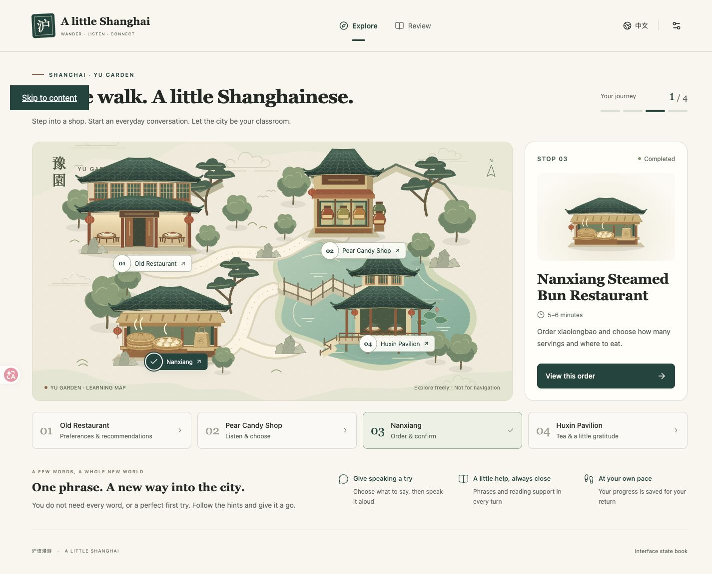

# 沪语漫游 · A little Shanghai

在豫园的四个虚拟地点练习日常上海话。批次 A 修订 4 已通过用户验收，**B+C：四站完整实现**已完成开发与工程检查，加入老饭店、梨膏糖商店和湖心亭茶楼，等待用户体验验收。四站保留固定题目、正误反馈、点击继续与完成后复习；语言与声音仍是供审阅的候选材料。范围见 [B+C 计划](docs/Batch-BC-plan.md)，实际检查见 [B+C 验收记录](docs/Batch-BC-acceptance.md)。

最新修订 [批次 2 修改 1](docs/Batch-2-revision-1.md) 已实现结束语播放修复、四站状态总览与逐句双速复习，并接入已选“园亭对话”Logo；检查与截图见 [修订验收](docs/Batch-2-revision-1-acceptance.md)。



## 本地启动

需要 Node.js 22.12+、Python 3.11。依赖版本固定在 `package-lock.json` 和 `backend/requirements.lock`。

```sh
npm ci
python3.11 -m venv backend/.venv
backend/.venv/bin/python -m pip install -r backend/requirements.lock
```

首次配置时将 `.env.example` 复制为 `.env`。**已有 `.env` 时不要覆盖**。Key 仅填在服务端配置文件；它已被 Git 忽略，不要放进 `VITE_*` 或前端代码。

```sh
npm run dev
```

打开 [本地预览](http://127.0.0.1:5173)。更新后端代码后需重启开发服务；若提示 5173 或 8000 已被占用，先在原启动终端按 Ctrl+C，再启动一次，不要重复开启。该命令同时启动 Vite 和 FastAPI，默认仅监听本机；关闭终端或 Ctrl+C 停止两个服务。Windows 可分别使用 `npm run dev:web` 与虚拟环境内的 Python 启动后端，详见 [API 说明](backend/API.md)。

- `/#map`：自由进入四站，显示真实完成状态与继续入口。
- `/#restaurant`：说明不辣偏好、问推荐、选择菜品及核对。
- `/#candy`：听介绍辨口味、购买两包及核对；可使用文字帮助。
- `/#teahouse`：评价茶并道谢，自然结束。
- `/#nanxiang`：逐题交流、说话/选择回应、内嵌语言提示、订单核对与完成。
- `/#review`：四站状态总览，未开始时也可访问；点击已完成站点进入 `/#review/{station}`，每句可直接播放标准速/慢速，重练不失去复习资格。
- `/#design`：录音、等待、失败、核对、完成、学习支持的静态状态册，**不写入任务进度**。

本地 SQLite 数据在 `backend/data/`，刷新与重启后恢复同一浏览器 Cookie 会话。设置中的「开始新的探索」会在明确确认后切换到新匿名会话，保留偏好但不转移旧进度；数据库、录音、诊断文件和 Key 不提交 Git。

## 当前可用范围

B+C 的三个新站使用独立室内场景、角色动作、菜单/糖罐/茶具；复用语音录制、字音对齐、声音播放、设置和持久会话。餐厅区分推荐与实际选择；糖店每次尝试的目标固定，默认隐藏目标介绍文字，播放结束或主动查看文字帮助后继续；茶楼没有订单式确认。已完成站点可复习，路线回顾按不同地点统计，提前访问茶楼不冒充四站完成。

新增 36 条教学与店员表达，配齐无声调数字的字音对齐注音和本地音频（35 条新制、1 条复用）；1×/0.75×共用文件，播放时不调用 TTS。三站使用独立内容及规则版本，已有 R3/R4 南翔会话可以继续使用，无需清空进度。B+C 未新增真实 ASR 或自由对话模型调用，真人麦克风和语言听审仍需补验。

以下南翔基线继续保留：

- 原创可编辑 SVG 地图、四种不同建筑与南翔角色动作，桌面/手机与中英界面。地点卡按站点/状态、独立插画、全宽店名、时长/短说明、主按钮排列；去除重复提示与首页、页脚预览入口。
- 每次显示一道既定问题：商品、数量、堂吃或外带、最终核对；取消所有临时追问。先选本题目标再 Speak，选择和评估均不推进订单。
- 说完后自动识别核对，始终展示原始转写与是否符合本题；正确后点击“下一步”，不正确可重试或明确“用所选答案继续”。没有转写与技术故障显示真实空态，不伪造语音正确。
- 数量统一按份，当前教学选项为一/二/三份，底层保留 1–20 份合法范围。核对只应用当前题目标；冲突数字不会悄悄修改订单。最后店员完整复述商品、份数、堂吃/外带，再问“对伐？”；修改订单后句子与声音同步。说出确认后也先停留结果，明确点击“确认并完成”且保存成功后才完成。
- 匿名会话、设置、尝试、跳过、重练、幂等请求、取消/迟到保护和查询恢复。
- 主动开始/停止录音、20 秒上限、内存转 PCM WAV；结束后自动识别并核对原始转写。结果、目标和失败回退资格随题目持久保存；取消、切题、离开后的旧结果不会推进，保存结果未知时提供查询/取消恢复。
- 20 条沪语汉字与拉丁注音审阅稿，字音对齐，界面不显示声调数字，注音默认开且可隐藏。当前题直接显示语言支持，Phrase book 按钮已移除，完成后在 Review 复习。
- R3 基础材料复用 R2 的 20 条本地声音，R4 独立增加六种完整订单确认声音，均以原文/版本严格匹配；历史追问不进入当前流程。标准 1×、保留音高的慢速 0.75×共用素材，不在播放时调用 TTS；所有语言与声音批准仍待真实审阅。

R3/R4 使用有限、确定性的目标表达核对，不调用自由对话模型，不输出逐字发音评分。历史自由输入保留 `development_parser` 与可选 Qwen 解释器。语音配置默认关闭；有已授权账户后可以单独设置 `QWEN_ASR_ENABLE_LIVE=true`。实际服务诊断及历史样音生成见 [调用记录](docs/Speech-integration.md)。模型和基础内容版本绑定会话；R4 是 R3 的界面与独立确认资源更新，已有 R3 进度刷新即可使用，无需新探索。R1/R2 旧会话仍保留原版本，使用 R3 引导课程需明确「开始新的探索」，不静默改变旧记录的来源。

最初接口诊断使用合成英文短音频；修订 1 制作了沪语整句常速样音，修订 2 补齐通用订单台词，修订 4 新增六种完整确认句。生成与可播放不代表发音已经准确，真人参考读法、慢放听感和独立人工审核仍待完成。R1 历史审阅见 [原注音与声音清单](docs/content-review/Pronunciation-draft-r1.md)，最新声音和验证见 [修订 4 验收](docs/Batch-A-revision-4-acceptance.md)。

## 检查与构建

```sh
npm run check        # 类型、内容/前端/后端回归、审阅音频完整性
npm run build        # 开发预览构建，允许显式待审内容
npm run build:release
```

`build:release` 当前**应失败**：正式发布前，文字、注音、近似读音、音频文件与独立审核记录必须满足全部条件。这不是编译故障。不要绕过发布门槛将开发包当正式教材。

`npm run preview` 在同一端口预览已构建的前端，需要单独运行后端；不要和 `npm run dev` 同时启动。

自动化测试强制禁用真实模型调用，不消耗 API 用量。真实验证需按 [语音说明](docs/Speech-integration.md) 有意识地执行；运行真实调用会产生账户费用。

## 目录与交接

| 位置 | 内容 |
| --- | --- |
| `frontend/` | React、界面、原创场景、录音与语言资源 |
| `backend/` | FastAPI、SQLite、确定性规则、提供商适配器与测试 |
| `content/` | 版本化开发内容、独立审核账本、内容类型与门槛测试 |
| `scripts/` | 双服务启动、内容验证和语音制作入口 |
| [设计交接](docs/design/Batch-A-design.md) | 设计系统、图层、交互和适配边界 |
| [批次 A 验收](docs/Batch-A-acceptance.md) | 实际检查、截图与未完成项 |
| [批次 A 修订 1](docs/Batch-A-revision-1.md) | 已确认修订范围与逐项验收条件 |
| [修订 1 验收](docs/Batch-A-revision-1-acceptance.md) | 历史实测、12 张截图与待审核项 |
| [批次 A 修订 2](docs/Batch-A-revision-2.md) | 历史需求；字音对齐、速度与完成后复习继续有效 |
| [修订 2 验收](docs/Batch-A-revision-2-acceptance.md) | 自由点单、语音流程、完成后复习及验证边界 |
| [批次 A 修订 3](docs/Batch-A-revision-3.md) | 当前确认：固定题目、正误结果、明确继续与辅助回退 |
| [修订 3 验收](docs/Batch-A-revision-3-acceptance.md) | 327 项回归、结果恢复与中英桌面/手机截图、验证边界 |
| [批次 A 修订 4](docs/Batch-A-revision-4.md) | 精简提示、完整确认句、完成按钮与地点卡要求 |
| [修订 4 验收](docs/Batch-A-revision-4-acceptance.md) | 370 项回归、六条确认声音、七张截图及验证边界 |
| [B+C 合并计划](docs/Batch-BC-plan.md) | 已授权四站范围、最新固定流程与验收边界 |
| [B+C 场景设计](docs/design/Batch-BC-design.md) | 三站场景、角色、物件与响应式状态 |
| [B+C 验收记录](docs/Batch-BC-acceptance.md) | 三站实现、工程检查、画面与未验证项 |
| [批次 2 修改 1](docs/Batch-2-revision-1.md) / [验收](docs/Batch-2-revision-1-acceptance.md) | 结束语播放、Review 总览/详情及逐句双速、园亭对话 Logo |
| [内容审核交接](docs/content-review/README.md) | 两位流利使用者可填写的审核资料 |
| [开发进度](docs/Development-status.md) | 当前状态与下一项工作 |
| [开发路线](docs/Product-development-roadmap.md) | 批次与十步的原始范围 |

没有创建生产网址或云数据库。B+C 后续为 D：完整路线的发布验收与环境准备；E：正式部署。真实麦克风、实体设备和语言听审的覆盖以验收记录为准，开发预览不等于正式教材批准。
