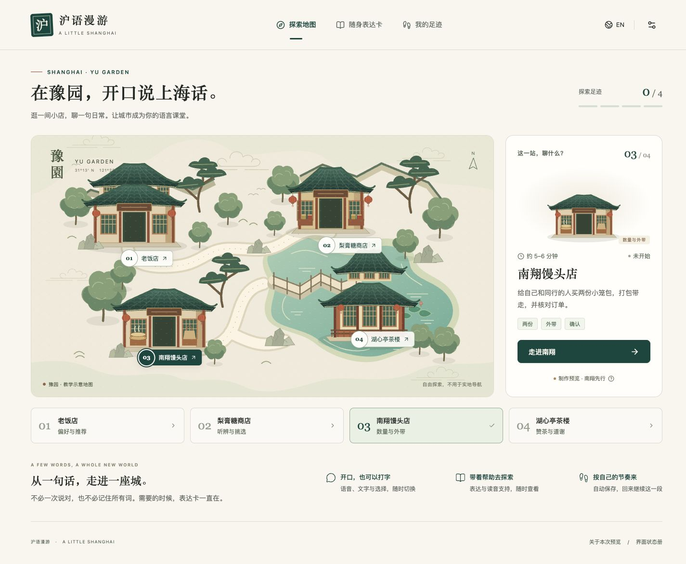

# 沪语漫游 · A little Shanghai

在豫园的四个虚拟地点练习日常上海话。当前交付为**批次 A 的地图/南翔设计、内容审核包和可运行工程基础**；南翔完整教材、四站产品和正式部署尚未完成。



## 本地启动

需要 Node.js 22.12+、Python 3.11。依赖版本固定在 `package-lock.json` 和 `backend/requirements.lock`。

```sh
npm ci
python3.11 -m venv backend/.venv
backend/.venv/bin/python -m pip install -r backend/requirements.lock
```

首次配置时将 `.env.example` 复制为 `.env`。**已有 `.env` 时不要覆盖**。Key 仅填在服务端配置文件；它已被 Git 忽略，不要放进 `VITE_*` 或前端代码。

```sh
npm run dev
```

打开 [本地预览](http://127.0.0.1:5173)。该命令同时启动 Vite 和 FastAPI，默认仅监听本机；关闭终端或 Ctrl+C 停止两个服务。Windows 可分别使用 `npm run dev:web` 与虚拟环境内的 Python 启动后端，详见 [API 说明](backend/API.md)。

- `/#map`：四站地图，当前可进入南翔。
- `/#nanxiang`：到店任务、三种输入、学习卡、订单、修改与完成。
- `/#review`：按实际已保存记录显示足迹，重练不重复计地点。
- `/#design`：录音、等待、失败、核对、完成、学习支持的静态状态册，**不写入任务进度**。

本地 SQLite 数据在 `backend/data/`，刷新与重启后恢复同一浏览器 Cookie 会话。设置中的「开始新的探索」会在明确确认后切换到新匿名会话，保留偏好但不转移旧进度；数据库、录音、诊断文件和 Key 不提交 Git。

## 当前可用范围

- 原创可编辑 SVG 地图、四地标和南翔柜台/角色，桌面/手机与中英界面。
- 文字与按钮通过同一服务端规则；初始空订单、两份/两只、堂吃/外带、修改与摘要版本校验；后端保存后才显示完成。
- 匿名会话、设置、尝试、跳过、重练、幂等请求、取消/迟到保护和查询恢复。
- 主动录音、20 秒停止、本地回听、明确上传、内存转 PCM WAV；ASR 转写核对后再提交，原转写与编辑稿分别记录。
- 南翔 E08/E09/E05 候选、12 条店员双语语义稿、审核表与发布门槛。

文字默认采用明确标示的 `development_parser`，只覆盖有限开发示例。已实现可选 Qwen 解释器，但不把有限解析器冒充大模型。语音配置默认关闭；有已授权账户后可以单独设置 `QWEN_ASR_ENABLE_LIVE=true`。本次已按用户授权完成少量真实 ASR/LLM/Jada 接口诊断，详见 [实际调用记录](docs/Speech-integration.md)。模型配置绑定会话，修改配置后从设置选择「开始新的探索」使用新的匿名会话，不静默改变旧会话的来源。

真实诊断使用的是**合成英文短音频与非教材英文短句**，不是上海话发音或教学质量验收。当前所有教材读音、参考音频、常/慢速示范和双人审核仍待完成，界面清楚显示待审。

## 检查与构建

```sh
npm run check        # 类型、21项内容门槛回归、后端规则/API/提供商测试
npm run build        # 开发预览构建，允许显式待审内容
npm run build:release
```

`build:release` 当前**应失败**：正式发布前，文字、注音、近似读音、音频文件与独立审核记录必须满足全部条件。这不是编译故障。不要绕过发布门槛将开发包当正式教材。

`npm run preview` 在同一端口预览已构建的前端，需要单独运行后端；不要和 `npm run dev` 同时启动。

自动化测试强制禁用真实模型调用，不消耗 API 用量。真实验证需按 [语音说明](docs/Speech-integration.md) 有意识地执行；运行真实调用会产生账户费用。

## 目录与交接

| 位置 | 内容 |
| --- | --- |
| `frontend/` | React、界面、原创场景、录音与语言资源 |
| `backend/` | FastAPI、SQLite、确定性规则、提供商适配器与测试 |
| `content/` | 版本化开发内容、独立审核账本、内容类型与门槛测试 |
| `scripts/` | 双服务启动、内容验证和语音制作入口 |
| [设计交接](docs/design/Batch-A-design.md) | 设计系统、图层、交互和适配边界 |
| [批次 A 验收](docs/Batch-A-acceptance.md) | 实际检查、截图与未完成项 |
| [内容审核交接](docs/content-review/README.md) | 两位流利使用者可填写的审核资料 |
| [开发进度](docs/Development-status.md) | 当前状态与下一项工作 |
| [开发路线](docs/Product-development-roadmap.md) | 批次与十步的原始范围 |

没有创建生产网址、云数据库或付费基础设施。后续批次 B 需用审校后的真实材料接通南翔完整体验，再按 20 项站点用例与设备要求验收；其他三站与正式部署依既定路线推进。
