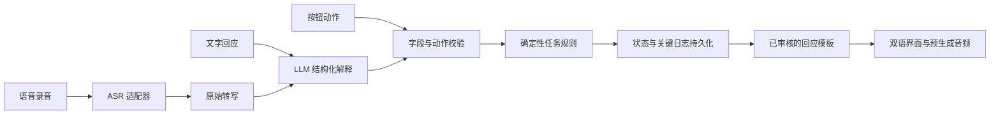

# 上海话虚拟城市探索：完整开发方案

当前 D/E 安排（2026-10-17）：按 [批次 D/E 计划](Batch-DE-plan.md)，D 先完成部署准备与部署，交付“已部署、待完整验收的版本”；E 再集中完成真人语音、设备兼容、ASR/TTS 工程验证与效果评估、语言和声音审核、综合修正与最终验收。保留步骤编号，执行顺序改为 **1–8 → 10（D）→ 9（E）**。D 保留部署成功所需的基本检查；不伪造内容 approved 状态，也不把部署成功当作最终验收。此次只更新计划，不修改构建脚本或执行部署。

当前账号与入口修订（2026-10-17）：用户已授权 [批次 2 修改 3](Batch-2-revision-3.md)，新增用户名密码账号、可选临时游客、游客进度承接及账号保存；导航为 About / Explore / Review，登录后默认 About。下方历史“匿名长期保存／账户后置”由本修订覆盖，任务与教学范围不变，实际进度见 [开发进度](Development-status.md)。

当前实施决定（2026-10-17）：用户已通过批次 A 修订 4，并授权 [批次 B 与 C 合并开发](Batch-BC-plan.md)。三站采用各自既定问题，沿用先选再说、结果停留、明确继续、失败辅助及完成后 Review；取消旧草案的临时追问、Type 和自动推进。具体固定流程与交付边界以合并计划为准。

当前覆盖性决定（2026-10-17）：[批次 A 修订 4](Batch-A-revision-4.md) 精简中英常驻提示、将实际订单带入最后确认及配套声音、统一完成按钮并重排地点卡。流程沿用 [修订 3](Batch-A-revision-3.md)：只保留商品、数量、方式、订单核对四道既定问题，取消临时追问；识别后显示原转写与正误，明确点击继续才推进，失败可重试或辅助继续。未覆盖部分沿用 [修订 2](Batch-A-revision-2.md)；下方历史冲突规定由最新修订覆盖，实际完成状态见 [开发进度](Development-status.md)。

版本：v0.8 · D 部署先行、E 集中验证与最终验收

日期：2026-10-17  
当前阶段：A 已获用户通过，B+C 及后续修订已有工程交付；当前更新 D/E 计划，实际进度以开发进度文件为准。

本方案根据 [P1 决策记录](P1-draft.md) 与 [研究 proposal](../References/proposal.md) 编写。已确认事项继续有效；其余内容均为本次提出的推荐默认方案，供一次性总体审阅。建议获整体认可后再整理为实施基线，不要求逐条确认。

当前实施入口为 [产品开发步骤：从现有 Markdown 到完整产品](Product-development-roadmap.md)。按用户最新要求，从既有草案直接展开设计、制作、实现、工程验收与发布，不再把方案确定、用户测试和正式研究列成开发阶段。本文件保留产品规格及原研究背景；其中研究设想不属于本轮产品完成条件。P1 草稿继续保存已确认决定。

## 阅读路径

- 产品与体验：第 1–5 节。
- 四站任务、对话与内容：第 6–10 节。
- 每站页面、UI、脚本、素材、语音、规则、数据、工作包与验收：[四站独立开发草案入口](Route-drafts-index.md)。本轮按用户要求全部展开供审阅，新增细节仍为建议。
- 系统与数据规格：第 11–14 节；第 15 节为本轮范围外的研究参考。
- 从现有草案到完整产品的十步实施与交付：[产品开发步骤](Product-development-roadmap.md)，概要见第 16–17 节。

## 1. 总体方案与决策边界

### 1.1 产品定义

制作一个适合初学者的双语 Web App。用户沿豫园地区的四个虚拟地点完成一次约 20–30 分钟的体验，通过短对话理解和使用上海话。每站都有明确交流目标、可随时使用的语言支持和可修改的回应。

产品采用“场景探索 → 理解任务 → 尝试交流 → 获得帮助 → 完成与回顾”的循环。交互以语音为主要入口，文字和按钮始终可用；任务完成、语音尝试和使用帮助分别记录。

首版重点交付：一套完成度高的视觉与交互设计、一条有场景氛围的探索路线、一套可靠的任务逻辑、经过审核的语言内容，以及能支撑研究问题的数据。UI 与场景体验作为独立的核心工作线，安排设计、制作、实现和验收。

### 1.2 已确认事项

| 编号 | 已确认要求 |
| --- | --- |
| C01 | 现有 HTML prototype 仅用于向老师展示进度；正式产品的 UI、功能和内容重新开发 |
| C02 | 同时覆盖会普通话但不会上海话的用户，以及主要使用英语、可能不认识汉字的用户 |
| C03 | 设置中可以切换中文和英文；英文模式保留核心表达汉字，其余说明使用英语 |
| C04 | 鼓励语音，但允许文字、按钮或组合方式完成任务，不强制先尝试语音 |
| C05 | 任务完成与语音练习分开记录 |
| C06 | 保留上海老饭店、上海梨膏糖商店、南翔馒头店、湖心亭茶楼四个地点 |
| C07 | 上海老饭店：表达不吃辣、请求推荐、确认菜品 |
| C08 | 梨膏糖商店：听懂口味介绍、选择对应的糖、购买两包 |
| C09 | 南翔馒头店：点两份小笼包、表达外带需求、确认订单 |
| C10 | 湖心亭茶楼：正面评价茶、向店家道谢 |
| C11 | UI 设计也是重要的产品要求；方案需要充分重视视觉与交互体验 |
| C12 | ASR/TTS 必须为未来使用团队自行部署的模型预留升级路径；初期 API 接入不能将产品绑定到单一提供商 |
| C13 | 前期 ASR 与 TTS 都先采用能提供 API 的服务，自部署模型不作为产品开发的前置条件；初选与验证安排见第 11.3 节 |
| C14 | 中英文模式保留核心上海话汉字和对应语言释义，共用统一的上海话拉丁注音及常速/慢速示范音频；拉丁注音默认显示、可隐藏，按词组对齐并配对应语言的读法说明 |
| C15 | 仅中文模式提供默认收起的“中文近似读音”入口，展开显示经审校的谐音辅助并标注“近似读音，请结合音频”；不替换上海话原句或释义，英文模式不显示该入口和内容 |
| C16 | 本轮开发步骤直接基于现有 Markdown，直到完整产品；不包含再次确定产品/四站方案、参与者用户测试、研究型模型对照实验和用户研究。E 包含项目 ASR/TTS 工程验证、效果评估、内容审核与最终验收 |
| C17 | D 先部署准备再部署；E 再集中进行真实语音、设备和兼容性检查、ASR/TTS 验证评估及语言听审。步骤编号不变，执行顺序为 1–8 → 10（D）→ 9（E）；D 上线待完整验收版，E 通过后才作最终验收 |

### 1.3 推荐默认方案

| 设计选择 | 推荐方案与理由 |
| --- | --- |
| 产品形态 | 响应式 Web App，兼顾桌面与手机；便于本地用户研究和分享访问 |
| 场景呈现 | 围绕豫园探索建立统一艺术方向，完整设计地图、四个店铺空间、角色、物件、镜头转场和交互反馈；分层插画作为初始候选，具体表现形式通过高保真样稿和设备表现确定 |
| UI 设计 | 作为核心交付，独立制作视觉规范、核心页面高保真设计、交互状态与动效说明，并为实现后的视觉调整预留时间 |
| 路线 | 老饭店 → 梨膏糖商店 → 南翔 → 茶楼；按表达偏好、听辨、订单组合、社交表达组织学习 |
| 内容量 | 12 组核心表达，另配少量帮助和修改表达；不要求用户全部记住 |
| 语言支持 | 按 C14/C15：汉字、对应语言释义、默认显示且可隐藏的拉丁注音、共用常速/慢速上海话音频，以及仅中文模式按需展开的近似读音 |
| 对话方式 | LLM 理解用户意图，确定性规则判断下一步；店员使用已审核的模板与预生成音频 |
| 语音服务 | 初期 ASR 试用 qwen3-asr-flash，TTS 试用 qwen3-tts-flash + Jada；统一内部调用约定，未来增加自部署适配器；效果与账户可用性在产品开发步骤 4 接入验证 |
| 会话 | 匿名开始，自动保存当前进度；无需注册账户即可体验 |
| 首版范围 | 单条路线、四个场景、单人体验、完成回顾、研究日志导出 |
| 暂后置 | 自由开放聊天、实时生成上海话语音、自动发音评分、多人互动、账户体系和更多路线 |

以上范围是为了让首版能在两人团队和 proposal 的研究周期内形成完整交付。它们是本次建议，不是新的已确认事实。

## 2. 当前产品开发范围

现有四站 Markdown 是本轮实施起点，最终交付是可访问、可维护的完整 Web App。按 [产品开发步骤](Product-development-roadmap.md) 保留十个步骤编号：1–4 为 UI、素材内容、应用基础与语音任务能力，5–8 为四站实现，9 为综合验证与质量修正，10 为部署准备与部署。当前执行顺序为 1–8 → 10（D）→ 9（E），详细交付边界见 [批次 D/E 计划](Batch-DE-plan.md)。

设计、素材制作和工程基础可以部分并行；待审内容按既有修订可用于开发和 D 的待验收部署，必须保留真实审核状态。语言与声音审核在 E 完成后才能作为已批准教材交付。E 的模型验证是项目 ASR/TTS 工程效果与可靠性评估；参与者用户测试、研究型模型对照实验和研究报告不属于本轮阶段或交付门槛。原 P1/P2/P3 研究阶段划分保留于 proposal 与历史记录，不作为本轮执行清单。

## 3. 完整用户旅程

### 3.1 首次进入

1. 显示产品简介与语言选择：中文 / English。首次参考浏览器语言，但始终允许更改。
2. 用当前语言说明：“沿四个地点完成简短交流。你可以说话、打字或选择回应。”
3. 提供“听一个示例”入口，让用户先确认设备能播放声音。
4. 提供可跳过的录音体验；只在用户第一次点击录音时请求麦克风权限。
5. 进入路线地图；研究模式在此之前显示研究说明及相应同意选项。

麦克风权限被拒绝时，仍可进入所有场景并使用文字和按钮。浏览器录音需要安全上下文与用户许可，因此部署使用 HTTPS，并覆盖拒绝权限后的提示与恢复。[MDN：getUserMedia](https://developer.mozilla.org/en-US/docs/Web/API/MediaDevices/getUserMedia)

### 3.2 路线与时间

| 部分 | 建议体验时间 | 设计作用 |
| --- | --- | --- |
| 介绍与熟悉操作 | 2–3 分钟 | 理解输入方式和学习支持 |
| 上海老饭店 | 5–6 分钟 | 建立“表达需求—推荐—确认”的基本交流方式 |
| 上海梨膏糖商店 | 5–7 分钟 | 增加听音辨别与数量表达 |
| 南翔馒头店 | 5–6 分钟 | 组合商品、数量和外带方式，练习修改与确认 |
| 湖心亭茶楼 | 3–4 分钟 | 用评价与道谢收尾 |
| 路线回顾 | 1–2 分钟 | 回看表达，选择重练 |

总计约 21–28 分钟，作为设计目标而非计时限制。语音重试、查看帮助或无障碍需求不触发超时失败；介绍与熟悉操作预算包含地图进入及短转场，最终以试运行校准。

地图是学习路线示意，不用于真实导航，不声称比例、位置关系或步行耗时精确。每站结束后用短转场回到地图，用户主动进入下一站。

### 3.3 路线自由度与进度

- 默认突出建议的下一站，允许进入其他站点；任务均可独立理解。
- 完成的站点可回看和重新练习；重练创建新的 attempt，保留首次尝试数据。
- 提供“稍后再做 / Do this later”。跳过标为“未完成”，不计入成功完成数。
- 设置中切换语言保留当前地点、已采集信息和历史对话；仅重绘展示语言。
- 刷新恢复最近一次已成功保存的状态；正在录制但尚未提交的音频不自动重放或提交。
- 完成回顾显示“四站中完成了几站”，不会把走完地图、跳过或看过场景等同于任务完成。

## 4. 双语、读音与输入方式

### 4.1 展示矩阵

| 内容 | 中文模式 | 英文模式 |
| --- | --- | --- |
| 页面、设置、按钮、错误提示 | 普通话中文 | 英语 |
| 任务说明、文化说明、帮助说明 | 普通话中文 | 英语 |
| 核心上海话表达 | 汉字 + 普通话释义 + 注音 | 汉字 + 英文释义 + 注音 |
| 拉丁注音 | 默认显示，可隐藏；配中文读法说明 | 默认显示，可隐藏；配英文读法说明 |
| 中文近似读音 | 入口默认收起，用户展开后查看审核过的谐音辅助 | 不显示入口或内容 |
| 地点名称 | 中文名称 | 英文名称；场景中的可读界面招牌同步适配 |
| 示范和店员语音 | 上海话 | 上海话 |
| 订单与选择摘要 | 当前语言的商品、数量及选项 | 当前语言的商品、数量及选项 |
| 原始 ASR 转写 | 可展开查看 | 可展开查看；解释和操作仍使用英语 |

界面语言控制说明方式，不改变用户需要练习的上海话内容。自己的输入或识别原文属于可查看的记录，不要求英语用户靠它完成操作；主要反馈使用英语语义摘要。

英文地点名称统一使用：Shanghai Old Restaurant、Shanghai Pear Candy Shop、Nanxiang Steamed Bun Restaurant、Huxin Pavilion Teahouse。名称表集中维护，避免页面出现多个译法。

### 4.2 表达卡规格

一张表达卡以核心上海话汉字和按词组对齐的拉丁注音组成句子区，注音放在对应词组上方；随后展示当前语言释义、紧贴句子的常速/慢速播放入口及“使用这句”。中文模式另有默认收起的“中文近似读音”入口，展开内容不替换原句或释义。上述展示原则已于 2026-10-17 确认，具体排版尺寸在高保真阶段验证。

- 默认只突出当前任务可能用到的 2–4 张卡；“全部表达”可查看更多。
- 点击“使用这句”将文字填入输入框，用户再次提交后才成为一次回应；单纯打开卡片或播放音频不计作表达了该意图。
- 英文释义必须传达实际交流意图，避免逐字翻译造成不自然英语。
- 使用统一的项目拉丁注音规范，两种模式默认显示、可隐藏，并配中英文读音说明；用户页面不默认显示 IPA 等专业标记。
- 注音字号和对比度保证清楚可读，按自然词组与汉字一起换行；隐藏注音不隐藏核心汉字、释义或音频入口。
- 中文谐音属于独立辅助内容，标注“近似读音，请结合音频”。切换英文模式后不显示该辅助的入口或内容；示范音频仍为上海话。
- 注音作为辅助，完整上海话音频作为学习依据。两位流利使用者确定句子的实际读法后，再填写注音；不把普通话拼音或未经审核的英文拟音当作上海话发音。
- 注音规范形成单独的内容说明，固定字母写法、分词、符号和读音示例；首版不并列多套互相矛盾的拼写。

本方案给出完整语义和候选汉字，但不会伪造已经审核的上海话注音。语言审校是进入用户测试前的内容交付步骤。

### 4.3 输入方式与认可范围

| 输入 | 推荐行为 | 数据处理 |
| --- | --- | --- |
| 语音 | 主按钮清楚可见，点击开始、再次点击停止；建议每次一句短话，最长 20 秒 | 识别后展示语义反馈；用户可更正识别结果或重新录制 |
| 文字 | 始终有入口；支持上海话汉字、普通话、英语表达同一任务意图 | 进入相同解释和校验流程；记录原始输入，不计为上海话口语掌握 |
| 按钮 | 始终有“选择回应”；选项清楚表达其实际含义 | 传入预定义动作或字段，经相同业务校验；服务端核对选项是否合法 |

用户说普通话或英语但表达了正确任务意图时，可以推动任务，同时记录为语音通道输入；不凭使用麦克风就宣称其讲了上海话。实际语种、混合语和发音质量若用于研究，需人工标注或另行验证的方法。

编辑 ASR 转写后提交，标为“语音后编辑”。原始转写与编辑文本分别保存，评测时不把人工修正后的成功归因于 ASR。

首版不承诺自由输入拉丁注音的自动理解；读音辅助主要用于开口，按钮和汉字填入可以完成等价回应。

### 4.4 学习支持不等于自动答对

帮助始终可用，但事件含义要分清：查看帮助、听示范、填入句子、提交回应是四种不同操作。用户查看完整答案后完成任务，仍记完成，同时记录使用了答案支持；完成回顾不使用“已经学会”“发音正确”等未经测量的判断。

### 4.5 两种界面语言下的具体学习方式：已确认原则与制作细节

两种模式练习同一套上海话表达、使用同一份审核通过的示范音频、遵循相同任务目标。用户于 2026-10-17 确认“共用拉丁注音 + 仅中文模式可展开的中文谐音辅助”方案，默认显示、隐藏、词组对齐及保留原句/释义的要求见 C14/C15。界面语言决定解释方式；具体注音拼写、谐音文本和音频仍需制作与审校，其他学习细节继续作为推荐设计。

**学习循环**：了解当前交流目的 → 听完整上海话 → 按需查看读音、慢听或分段跟读 → 自己尝试回应 → 看店员理解了什么 → 必要时调整。所有帮助可随时进入，不强制先上完一节发音课或完成跟读才能交流。

| 学习内容 | 中文模式 | 英文模式 |
| --- | --- | --- |
| 理解表达 | 核心上海话汉字、自然的普通话释义，必要时提示与普通话用词的差别 | 核心上海话汉字、自然英文释义，必要时配商品/数量图示；不要求先认字 |
| 读音行 | 统一上海话拉丁注音，按词组对齐；默认显示、可隐藏，可查看中文说明 | 相同注音及对齐规则；默认显示、可隐藏，以英文解释字母/组合的读法；不假定用户会普通话拼音 |
| 中文近似读音 | 点击默认收起的入口展开经审核的谐音提示，标明近似性质；原句和意思继续保留 | 不显示中文谐音及其入口 |
| 发音帮助 | 简短中文说明口型、气流或句子节奏；确有必要时采用经审校的普通话声音近似比较 | 简短英文说明口型、气流或句子节奏；可用熟悉的英语声音作近似比较，并说明差异 |
| 听与跟读 | 常速、慢速、适用时的分段播放；中文控件和练习提示 | 完全相同的上海话音频；英文控件和练习提示 |
| 回应后的反馈 | 中文显示已理解的意图和待补充信息 | 英文显示已理解的意图和待补充信息；原始汉字转写按需展开 |

拉丁注音属于上海话的读音辅助，不按普通话拼音或英语单词拼读规则直接解释。中文模式将普通话近似读音作为可展开的辅助，分别维护“上海话原句”“意思”和“中文近似读音”，避免用谐音字覆盖表达本身。谐音以批准音频为依据审校，并请中文初学者试读；无法用汉字给出有用近似的声音不强行拼凑，使用简短发音说明和音频帮助。英文模式提供英文读法说明，不增加中文谐音。

首次打开读音帮助时，建议提供可跳过的短引导，用实际示范音频解释项目采用的字母写法和分组符号。后台可以保留 IPA 或其他专业标注供审校，用户默认不需要学习专业符号表。当前采用的是截图启发的注音呈现方式，不将第三方截图中的全部汉字认定为普通话谐音，也不把其中的具体拼写自动定为本项目注音规范。

**音频分为四类**

| 音频 | 准备方式与使用场景 | 与学习反馈的关系 |
| --- | --- | --- |
| 店员对话 | 上海话欢迎、提问、澄清、确认和结束语；两种模式共用，可重播 | 默认提供当前语言释义；梨膏糖听辨目标的文字与翻译仍按需揭示，避免提前给出答案 |
| 核心表达整句示范 | 每组核心表达准备常速与慢速版本，中文/英文模式播放同一条 | 对照汉字、注音和释义学习；常速保留自然完整表达，慢速同样听审 |
| 较长表达的分段示范 | 仅在确有帮助的表达中，按流利使用者确认的自然语块制作；先听整句，再分段，最后回到整句 | 分组可以与汉字、注音及释义关联；不把逐字独立读音拼接成整句 |
| 用户自己的试读 | 用户主动录制，可本地回听并与示范先后播放；可重录或明确提交为任务回应 | 试听不自动提交，不给未经验证的发音分数；提交后才进入既定回应流程 |

上海话存在连读变调，完整表达的读法不能简单由单字读音机械拼出。以完整音频为依据、按自然语块辅助学习，是本项目据此提出的教学设计；具体分段仍由审校者判断。[Chen 与 Gussenhoven：Shanghai Chinese](https://www.cambridge.org/core/journals/journal-of-the-international-phonetic-association/article/shanghai-chinese/E58F14205E5EFF63067C6A180DB7AEEA)

初版中文/英文释义与操作说明以文字呈现，主要音频预算用于上海话对话和示范；不默认在每句上海话前后插播普通话或英文翻译。若后续增加释义朗读，应使用独立且明确标注的入口，并单独配置、审核相应语言音频，不能与上海话示范混用。

**表达卡内容示意**（“谢谢侬”是当前候选写法，仍需审校）

| 卡片内容 | 中文模式 | 英文模式 |
| --- | --- | --- |
| 核心汉字 | 谢谢侬 | 谢谢侬 |
| 读音行 | 与批准音频匹配的上海话拉丁注音，默认显示、可隐藏；具体拼写待审校 | 同一份注音及显示规则；具体拼写待审校 |
| 意思 | 谢谢你。 | Thank you. |
| 中文近似读音 | 默认收起；展开后显示待制作、审校的谐音辅助，标注“近似读音，请结合音频” | 不显示 |
| 练习提示 | 先听完整句，再跟着说；需要时播放慢速。 | Listen to the whole phrase, then repeat it. Use the slow version if needed. |
| 播放入口 | 听示范 / 慢速 | Listen / Slow |
| 尝试与使用 | 试着说 / 回听 / 填入回应 | Try saying it / Play mine / Use this phrase |

上表展示的是卡片结构，不提供未经审核的实际拼音、谐音文本或音频。正式内容制作时逐条形成“核心汉字—普通话释义—英文释义—实际读法—统一注音—中文近似读音—两种发音帮助—音频”的对应记录。先以南翔的点数量、表达外带、确认订单三类核心表达制作样例，让两类初学者试用，检查播放入口、注音说明、中文谐音试读及收起/展开的可用性，再扩展到全部表达。识别和任务成功只能提供交流反馈，不能自动证明发音准确。

## 5. UI 与页面设计规格

### 5.1 视觉方向

推荐“现代导览界面 + 有上海城市气质的场景艺术”。视觉设计要同时建立地点感、角色关系、探索意愿和清楚的操作层级。地图浏览、进入店铺、聚焦角色、互动反馈和离开场景形成连贯体验。

UI 与场景设计拥有独立的交付标准：明确的艺术方向、有辨识度的页面和四站空间、一致的角色与物件语言、完整的交互状态，以及适配中英文和不同屏幕的排版。

二维、分层插画、视差或适量三维元素是表现手段。初始建议从有空间层次的插画方案探索，通过代表性高保真场景和目标设备检查确定最终形式；当前不将场景固定为四张静态图，也不预设必须制作完整三维城市。

- 背景采用浅米白，正文采用深灰褐；主操作用深青绿，暖红作为少量场景强调。
- 中文采用清楚的无衬线字体，英文采用系统无衬线字体；正文建议至少 16px。
- 核心汉字字号高于辅助说明；英文内容允许自然换行，不能依赖中文字符串长度设计固定高度。
- 交互控件建议至少 44px 高，焦点清楚；状态同时用文字和图形表达。
- 主要文本对比度以至少 4.5:1 为设计目标；实现后测量验证。
- 环境音默认关闭。开启后不覆盖示范与录音；减少动态效果设置下关闭装饰动画。
- 店员使用原创插画角色；视觉素材采用自制或有明确使用许可的来源。

### 5.2 页面清单

| 页面 / 区域 | 必需信息 | 主要动作 |
| --- | --- | --- |
| 欢迎页 | 产品目的、语言、输入方式、约需时间 | 开始 / 继续、切换语言 |
| 路线地图 | 四个地点、当前建议站点、完成状态 | 进入站点、回顾、设置 |
| 场景任务页 | 场景、当前目标、店员对话、用户回应、已知任务信息 | 说话、打字、选回应、打开表达卡、重播 |
| 表达卡抽屉 | 当前任务相关表达及语言支持 | 听常速 / 慢速、填入文字 |
| 确认面板 | 当前菜品或订单的自然语言摘要 | 确认、修改 |
| 单站完成页 | 本站完成反馈、核心表达回顾 | 下一站、回地图、再练一次 |
| 路线回顾 | 各站完成情况、练过的表达、可重练入口 | 重练、结束 |
| 设置 | 中英文、音频偏好、动态效果、清除当前进度 | 应用设置、重新开始 |
| 研究者页面 | 去身份化会话列表、版本、日志完整性、导出 | 查看和导出；与学习者页面分开 |

### 5.3 场景页布局

桌面：场景作为主画面的视觉主体，地点、路线和设置保持清楚。进入交流时构图聚焦店员与相关物件，对话和回应出现在稳定、易读的区域；表达卡和订单摘要按需展开。具体分区比例由高保真设计检验，不提前固定为 40%/60% 分栏。

手机：保留场景的关键构图和角色辨识度，任务说明可折叠，对话与回应在拇指易操作区域呈现。输入、表达卡和确认面板有明确的展开与收起关系；打开键盘时优先保证当前消息与提交入口可见。单独制作手机构图，不简单缩小桌面画面。

“已知信息”用自然语言显示，例如“数量：两份；用餐方式：待补充”，不把字段名、模型名、状态名和实验编号展示给学习者。

### 5.4 必须设计的状态

| 状态 | 呈现与恢复 |
| --- | --- |
| 未录音 | “点击说话”，文字与选择入口可见 |
| 正在录音 | 明显录音标记、计时、停止与取消 |
| 正在处理 | 显示“正在理解你的回应”；提供取消并切换输入方式 |
| 未获取有效语音 | “没有听清，可以再说一次，也可以打字或选择回应” |
| 网络或服务失败 | 保留当前任务和文字草稿，提供重试，不判定学习失败 |
| 信息缺失 | 一次只询问一个当前缺失的信息 |
| 信息冲突 | 复述冲突的选择，让用户澄清，不擅自猜测 |
| 待确认 | 展示完整摘要，提供明确的确认和修改入口 |
| 已完成 / 已跳过 | 两种状态分开显示；跳过可稍后再来 |

### 5.5 基础双语文案

| 意图 | 中文 | English |
| --- | --- | --- |
| 开始 | 开始探索 | Start exploring |
| 录音入口 | 点击说话 | Tap to speak |
| 文本入口 | 打字回应 | Type a reply |
| 选择入口 | 选择回应 | Choose a reply |
| 支持入口 | 看看怎么说 | See how to say it |
| 重播 | 再听一次 | Listen again |
| 慢速 | 慢速播放 | Play slowly |
| 确认 | 确认这个选择 | Confirm this choice |
| 修改 | 我想修改 | Make a change |
| 服务失败 | 暂时没能处理你的回应，请重试或换一种方式 | We couldn't process your reply. Try again or use another input method. |
| 无责反馈 | 还需要补充一个信息 | One detail is still missing. |
| 完成 | 这次交流完成了 | You completed this conversation. |

### 5.6 四站的视觉与互动方向

以下是为整体审阅提出的设计建议，具体风格以高保真样稿为准；均为原创教学场景，不声称真实店内布局复刻。

| 场景 | 视觉辨识度 | 与任务关联的互动 |
| --- | --- | --- |
| 上海老饭店 | 温暖木色、餐桌与菜单形成层次，店员和菜品是视觉焦点 | 浏览菜品、看到推荐与当前选择、用订单卡确认；选中反馈与真实任务状态一致 |
| 梨膏糖商店 | 陈列柜、包装和口味物件形成丰富但清楚的商品展示 | 主动播放店员介绍，查看口味、选择数量；各选项同等显著，避免视觉效果提前透露答案 |
| 南翔馒头店 | 蒸笼、出餐台、打包区形成清楚的空间关系 | 商品、份数和外带选择得到直观反馈；打包呈现与确认后的订单一致 |
| 湖心亭茶楼 | 茶桌、窗景、水面与柔和光线带来舒缓的收尾感 | 店员对评价和道谢产生自然反馈，完成后过渡到旅程回顾 |

地图需要设计地标的外形、路线视觉、地点状态、选中反馈、进入与返回转场。角色需要设计倾听、回应、等待和完成时的表现。动效服务于空间连续性、动作反馈和情绪氛围；持续动效可关闭，语音等待不使用虚假的任务成功动画。

### 5.7 独立的 UI 设计交付与评审

| 交付 | 具体内容 | 验收重点 |
| --- | --- | --- |
| 艺术方向与视觉规范 | 场景画风、构图、色彩、字体、图标、角色与物件风格 | 产品整体一致，四站各有辨识度，视觉参考与最终素材来源清楚 |
| 体验分镜 | 地图到店铺、进入交流、打开帮助、修改订单、完成与返回 | 画面连续、当前目标清楚、交互前后关系可理解 |
| 高保真关键页面 | 欢迎、地图、四站场景、表达卡、确认与回顾；关键页面有桌面和手机版 | 采用真实长度的中英文和候选内容，检验信息层级与留白 |
| 设计系统 | 色彩与排版规范、间距、控件、卡片、面板、状态和图标 | 页面能一致实现；录音、等待、错误、选择和完成均有设计 |
| 交互与动效说明 | 点击、焦点、抽屉、场景转场、角色反馈、加载和减少动态效果 | 操作反馈准确，动效可控，设备表现可接受 |
| 实现后的视觉验收 | 对照设计检查截图，并实际体验关键路径 | 构图、素材清晰度、字体、间距、双语、手机键盘与状态切换达到设计基线 |

安排方式：先形成一套完整主方案供集中审阅；正式页面实现以其为基线。模型和规则验证可以并行开展，代表性场景的 UI 设计需在该场景正式界面实现前完成。四站集成后安排一轮完整视觉与交互调整，进入试运行前同时检查功能和设计质量。

## 6. 四站任务设计的共同规则

后续四站方案均属于推荐设计。已确认的交流目标保持不变，下面补齐可实施的具体流程与边界。

1. 默认引导顺序清楚，但接受用户一句话提供多个信息，也允许先提供后面的信息。
2. 先解释并合并本轮全部有效信息，再判断下一步；发出推荐不能丢掉同轮表达的“不吃辣”。
3. 未提到的信息保持未知，不补猜；“没有提到外带”与“明确选择堂吃”必须区分。
4. 普通修正只改变对应字段；否定、清空和撤回需要显式记录。
5. 修改订单内容后，之前的确认失效，必须针对新摘要重新确认。
6. 语音转写不清、闲聊或“不知道”不能当作确认。
7. 用户的真实回应决定进度；看过表达卡、听过示范、店员说过某句，都不能代替用户表达。
8. 前三站使用确认面板；茶楼在评价与道谢都表达后自然结束，不增加额外确认。
9. 超出当前任务的话题简短引回场景；重复困难时增加支持，不无限要求重录。
10. 每站使用同一套版本化规则处理语音、文字和按钮，记录各自来源。

下面的对话表是普通话语义脚本和英文释义，用来明确内容与逻辑。真正播放的店员台词及教学汉字需完成上海话改写与审校，不直接把普通话脚本作为上海话示范音频。

## 7. 四站详细任务与对话方案

### 7.1 上海老饭店：找一道合口味的菜

**任务说明**

- 中文：你想点一道不辣的菜。告诉店员你的口味，问问有什么推荐，再确认一道菜。
- English: You'd like a dish that isn't spicy. Tell the server your preference, ask for a recommendation, and confirm your choice.

**场景与材料**

店员站在餐桌旁，桌上有简洁的图文菜单。首版练习菜单建议只有三道菜：清蒸鱼、白斩鸡、辣味豆腐；前两项在本练习中标为不辣，第三项标为辣。推荐先给清蒸鱼，用户可以选择白斩鸡。菜品名称和口味是教学情境数据，正式内容制作时复核；不宣称它们是该店当前真实菜单或固定做法。

店员仅在用户表达或选择了“请求推荐”后，将 `recommendation_requested` 记为满足。店员自行推荐不能代替用户完成询问目标。

**推荐对话路径**

| 轮次 | 店员的语义脚本 / English gloss | 用户可能回应的意思 | 系统记录 |
| --- | --- | --- | --- |
| 1 | 欢迎，今天想吃点什么？ / Welcome. What would you like today? | 我不吃辣，有什么推荐？ | 不吃辣；已请求推荐 |
| 2 | 推荐清蒸鱼，这道不辣。你想要这道吗？ / I recommend the steamed fish. It isn't spicy. Would you like it? | 就要这个 | 选择清蒸鱼 |
| 3 | 一份清蒸鱼，不辣。这样可以吗？ / One serving of steamed fish, not spicy. Is that right? | 对的 / 确认按钮 | 对当前选择的明确确认 |
| 4 | 好的，请稍等。 / Great. It'll be ready shortly. | 无需额外回应 | 完成，展示回顾 |

**分支和错误处理**

| 情况 | 推荐回应与处理 |
| --- | --- |
| 只说“不吃辣” | 保留偏好，温和提示还可以问店员推荐；显示“有什么推荐？”学习卡和对应回应按钮 |
| 先问推荐，未说明偏好 | 记录询问意图，再问“你吃辣吗？”；得到偏好后再给匹配推荐 |
| 直接选菜，尚未请求推荐 | 保留选择，提醒练习向店员问推荐；随后允许保留原选择，不强迫改成推荐菜 |
| 选择辣味豆腐 | 提醒“这道是辣的，任务需要选择不辣的菜”；保持任务未完成，不悄悄替换 |
| 说“不要鱼，要鸡” | 识别否定与替换，更新为白斩鸡，再呈现新摘要 |
| 说“这个”但尚无可指代推荐 | 询问指哪道菜；不要默认选第一项 |
| 表达顺序不同 | 保存有效意图，只补缺项，不要求按脚本逐句重说 |
| 确认阶段说“没听清” | 重播或展示摘要，保持待确认 |

**推荐完成条件**

同时满足：用户表达了不吃辣、用户请求过推荐、选择是练习菜单中的不辣菜、用户明确确认了当前版本的选择。以上意图可由不同输入方式组合达成。

成功反馈：“你表达了口味偏好，并确认了自己的选择。” / “You explained your preference and confirmed your choice.” 回顾偏好、询问推荐和选择表达，不把按钮完成描述为口语熟练。

完整实施提案见 [上海老饭店独立草案](Shanghai-old-restaurant-draft.md)：六种页面呈现、三菜菜单、推荐与用户选择的区分、指代和撤回、台词/音频清单、场景素材、数据与 16 项站点验收。新增细节仍待整体审阅。

### 7.2 上海梨膏糖商店：听出口味，买两包

**任务说明**

- 中文：听听店员介绍的是哪种口味，选对应的梨膏糖，再买两包。
- English: Listen for the flavor the shopkeeper introduces. Choose the matching pear candy and ask for two packs.

**场景与材料**

使用三个同等显著的练习口味：玫瑰、桂花、薄荷；每项有图片、相应学习汉字、当前语言释义和单独的读音示范。它们是候选教学选项，正式制作时核实语词与商品资料，不声称是店铺当前库存。

首次练习的目标口味在三个选项中分配，并固定在当前 attempt 内；重播不换题。研究模式尽量平衡分配不同口味，记录分配规则。菜单不预选正确答案，任务标题不出现目标口味。

三种口味都能在表达卡中查看。这样英文用户得到汉字和英文支持，但不会只看到正确答案。查看店员完整台词或翻译是明确的帮助操作，单独记录。

**推荐对话路径：以玫瑰为例**

| 轮次 | 内容的语义 / English gloss | 用户行为 | 系统记录 |
| --- | --- | --- | --- |
| 1 | 今天介绍的是玫瑰味梨膏糖。 / Today's featured pear candy is rose-flavored. | 播放，可重播 | 音频播放、结束或中断事件 |
| 2 | 你想要哪一种？ / Which one would you like? | 玫瑰味的梨膏糖 | 口味与商品 |
| 3 | 要几包？ / How many packs? | 两包 | 数量 2 |
| 4 | 两包玫瑰味梨膏糖，对吗？ / Two packs of rose-flavored pear candy. Is that right? | 对的 / 确认 | 确认当前订单 |
| 5 | 好的，请拿好。 / Here you are. | 无需额外回应 | 完成 |

用户也可以一次说“我要两包玫瑰味梨膏糖”，直接进入确认。

**听力与帮助的规则**

- 目标介绍默认播放上海话音频；完整台词与翻译折叠在“查看这句话 / Show what was said”中。
- 页面始终展示所有候选口味的学习汉字及当前语言释义。核心汉字的保留不等于提前标出本题答案。
- 用户可直接打开介绍文字，或在播放失败时使用文字；内容曝光方式记录为音频、文字或两者。
- 开始选择前至少接触一种介绍方式：播放介绍，或打开文字介绍。播放结束只能证明播放事件发生，不能证明用户真的听懂。
- 正确完成且未查看目标台词，可描述为“未查看目标台词的正确作答”；不能直接推断其听力已掌握。
- 查看目标台词后仍能完成任务，标记帮助使用，不降低用户侧完成反馈。

**分支**

| 情况 | 处理 |
| --- | --- |
| 口味不符 | 提醒“和刚才介绍的不一样，可以再听一次”；提供重播与文字帮助，不立即在错误提示里透露正确答案 |
| 只说“玫瑰味的” | 在当前仅有梨膏糖的商品上下文中允许关联商品；日志注明商品由已限定上下文补全 |
| 数量为一包或三包 | 保留口味，提醒任务需要两包，并提供数量表达 |
| 没听懂 | 可重复播放、使用慢速版、查看全部口味示范或查看目标台词 |
| 更改口味 | 更新口味后重新校验目标；数量保持已知，旧确认失效 |
| 点击播放后立即停止 | 如实记录中断；不把它记成完整播放 |

**推荐完成条件**

已接触介绍内容；用户选出的口味与本次目标一致；商品为梨膏糖；数量为两包；对当前订单完成确认。是否播放、是否看过目标台词、是否使用按钮单独保留。

完整实施提案见 [上海梨膏糖商店独立草案](Pear-candy-shop-draft.md)：固定目标分配、音频与文字帮助、避免无意透露答案、实际播放进度、三口味完整音频、商品与单位、状态和 18 项站点验收。接触音频不等于完整播放或听懂；文字支持不影响任务完成资格。

### 7.3 南翔馒头店：两份小笼包外带

**任务说明**

- 中文：给自己和同行的人买两份小笼包，选择外带，并核对订单。
- English: Order two servings of xiaolongbao to take away, one for you and one for your companion. Check and confirm the order.

**场景与材料**

场景呈现蒸笼、点单台和打包袋。练习菜单聚焦小笼包；数量提供一、二、三份，方式提供堂吃、外带。固定一份为本练习的一个标准份量，不要求用户学习价格、付款或真实门店装盒规格。

用户说“两笼”时，在本练习明确的一笼对应一份的约定下可接受；“两个小笼包”不能自动当作两份。该对应关系属于教学菜单规则，界面需说清楚。

**推荐对话路径**

| 轮次 | 店员的语义 / English gloss | 用户可能回应 | 系统记录 |
| --- | --- | --- | --- |
| 1 | 欢迎，想买什么？ / Hello. What would you like? | 两份小笼包 | 商品、数量 2、单位份 |
| 2 | 堂吃还是外带？ / For here or to go? | 打包带走 | 外带为真 |
| 3 | 两份小笼包，外带，对吗？ / Two servings of xiaolongbao to go. Is that right? | 对的 / 确认 | 确认当前订单 |
| 4 | 好的，给你打包。 / Great. We'll pack them for you. | 无需额外回应 | 完成 |

**分支**

| 情况 | 处理 |
| --- | --- |
| 只说“小笼包” | 询问数量；之后再询问用餐方式 |
| 一次说全商品、数量、外带 | 直接生成完整确认摘要，不重复问已知信息 |
| 说“两个” | 询问是两只还是两份，保留其他已知信息 |
| 说“一份” | 提醒本次任务是两份；允许纠正，不直接完成 |
| 说“堂吃” | 明确识别为堂吃，并提醒本次要带走；不能把 false 当作缺失，也不能当作外带已满足 |
| “不堂吃，要打包” | 以明确修正后的外带意图更新 |
| 确认时改成三份 | 更新用户意图，提示与任务数量不符；不使用旧确认完成 |
| 语音把两份识别为二百份 | 拒绝异常数值，询问数量；原始转写保留以便归因 |
| 只回答“好的”但没有待确认订单 | 不能完成，继续补充任务信息 |

**推荐完成条件**

商品为小笼包、数量是两份等价标准单位、外带为真、用户确认了当前订单版本。

此站作为 P2 首个端到端开发样例：字段明确，能够覆盖数量、否定、修正、追问和确认，并可用于验收真实语音链路。

完整实施提案见 [南翔馒头店独立草案](Nanxiang-experience-draft.md)，已扩展至 v0.2：保留六种连续呈现，补齐首批三组语言样例规格、份/笼/只、外带三值、确认修订、完整脚本/素材/数据、开发工作包及 20 项站点验收。新增细节仍待整体审阅。

### 7.4 湖心亭茶楼：赞茶与道谢

**任务说明**

- 中文：喝过茶后，练习告诉店家你觉得茶很好喝，并谢谢对方。
- English: After trying the tea, practice saying that you enjoyed it and thanking your host.

**场景与材料**

使用茶杯、茶壶与窗边座位形成安静的收尾场景。明确这是角色练习情境，不需要用户实际饮茶，也不将情境台词当作用户真实口味评价。

**推荐对话路径**

| 轮次 | 店员的语义 / English gloss | 用户可能回应 | 系统记录 |
| --- | --- | --- | --- |
| 1 | 请喝茶，觉得怎么样？ / Please enjoy the tea. How is it? | 茶很好喝 | 对茶的正面评价 |
| 2 | 很高兴你喜欢。 / I'm glad you like it. | 谢谢你 | 致谢 |
| 3 | 不客气，欢迎再来。 / You're welcome. Come again. | 无需额外回应 | 完成 |

用户一句话说“茶很好喝，谢谢你”即可同时满足两个意图。欢迎和结束语不增加额外任务。

**分支**

- 只道谢：保留致谢，店员询问对茶的评价。
- 只评价：店员自然回应；界面提示还可以向店家道谢，不让角色机械地要求“请谢谢我”。
- “茶不好喝”：不能因包含“好喝”而判作正面评价；界面提示本次练习目标，提供表达帮助。
- “还不错”“很香，我喜欢”：在明确指向茶且表达喜欢时可接受，不限定为逐字示范句。
- 单独“谢谢”：在当前对话上下文中可接受为向店员致谢。
- 系统播放店员台词、查看卡片或填入未提交：不视为用户表达；用户主动提交借助示范形成的回应仍可有效完成，不因使用学习支持而拒绝。

**推荐完成条件**

本 attempt 中用户明确表达过对茶的正面评价和致谢，且没有在完成前撤回对应意图；允许分轮或合并表达。保存完成后自然结束，不增加订单确认；路线回顾按四个不同地点的成功情况显示进度，提前进入茶楼不代表完成全程。

完整实施提案见 [湖心亭茶楼独立草案](Huxinting-teahouse-draft.md)：茶室与角色设计、评价对象和否定范围、自然道谢提示、部分/全部路线回顾、音频与素材、数据和 20 项站点验收。

## 8. 核心表达与语言内容制作

### 8.1 十二组核心表达

下表的上海话汉字是**供流利使用者改写和审核的候选**，不是已验证教材。语义目标和英文释义可以先用于设计；上海话最终写法、注音和音频必须以审核版本替换。表格中的模板算一组，口味或商品替换不另计成新的必学表达。

| ID | 普通话语义 | 上海话汉字候选：待审校 | English meaning | 主要使用位置 |
| --- | --- | --- | --- | --- |
| E01 | 你好 | 侬好 | Hello. | 各站可选开场 |
| E02 | 我不吃辣 | 我勿吃辣个 | I don't eat spicy food. | 老饭店 |
| E03 | 有什么推荐？ | 有啥推荐伐？ | What would you recommend? | 老饭店 |
| E04 | 就要这个 | 就要搿个 | I'll take this one. | 老饭店，商品选择 |
| E05 | 对的 | 对个 | Yes, that's right. | 前三站确认 |
| E06 | 我要［口味］的梨膏糖 | 我要［口味］个梨膏糖 | I'd like the [flavor] pear candy. | 梨膏糖商店 |
| E07 | 我要两包 | 我要两包 | Two packs, please. | 梨膏糖商店 |
| E08 | 我要两份小笼包 | 我要两份小笼包 | Two servings of xiaolongbao, please. | 南翔 |
| E09 | 打包带走 | 打包带走 | To go, please. | 南翔 |
| E10 | 这茶很好喝 | 搿茶老好吃个 | This tea is really good. | 茶楼 |
| E11 | 谢谢你 | 谢谢侬 | Thank you. | 茶楼，其他站复现 |
| E12 | 请再说一遍 | 请侬再讲一遍 | Could you say that again? | 所有站的帮助 |

补充支持表达包括“不是这个”“我想换一个”“一份还是两份”“堂吃”“外带”和三种口味名。它们出现在必要的帮助或菜单中，不增加强制记忆要求。菜单中的“份 / 包”需有简短英文单位说明。

### 8.2 审核与版本流程

1. 根据本方案确定每条内容的交流意图、上下文和英文释义。
2. 流利上海话使用者改写自然的上海话文本，列出可接受的变体。
3. 第二位使用者独立检查自然度、汉字用法、释义和适合初学者的长度；分歧形成记录并统一。
4. 录制参考读法，据实际读法编写统一注音、中英文读音说明和仅中文模式使用的近似读音；分别审核原句、释义与辅助文本，并通过中文初学者试读检查谐音是否引起明显误读。
5. 初期通过 TTS API 制作音频，未来可切换到自部署 TTS；两种来源都必须经过听审。研究候选模型另行运行比较并保留原始输出，不能把商用 API 输出视为某个开放 checkpoint 的实验输出。
6. 常速和慢速分别审核。慢速可以重新生成或制作保音高慢速版本，但不能简单逐字拼接；制作参数固定。
7. 内容记录依次进入 draft、language-reviewed、audio-reviewed、approved；只有真实 approved 内容进入最终验收构建或未来正式研究构建。D 的待验收部署允许使用仍待审的现有教学内容，保留状态与版本；语言及声音审核在 E 完成。当前 `build:release` 会拦截 pending 内容，D 必须另行实现有明确标识的待验收构建路径，不把 pending 改成 approved 来绕过门槛；此次文档更新不修改该脚本。
8. 每次改词、改音频或改注音提升内容版本；研究会话固定使用开始时的内容版本。

若 TTS 个别片段审核未通过，教学音频可换成人工录音以保证体验，并记录来源；TTS 比较结果仍保留原始模型输出，不用人工录音替换实验样本。

### 8.3 内容对象的必需字段

| 对象 | 必需内容 |
| --- | --- |
| Expression | ID、上海话汉字、普通话释义、英文释义、统一注音、仅中文模式的近似读音及其审核状态、中英文发音帮助、适用时的自然语块及音频对应、使用意图、变体、适用场景、审核状态与版本 |
| DialogueTemplate | 模板 ID、触发条件、角色、上海话文本、两种释义、可替换参数、对应音频、版本 |
| TaskDefinition | 地点、说明、目标、字段约束、状态规则、允许动作、菜单、支持资源、完成条件、版本 |
| AudioClip | 片段 ID、文本 ID 与版本、语速、文件地址与校验值、时长、音频来源、提供商与部署方式、模型与推理配置、声音配置版本、审核记录 |
| VisualAsset | 场景或物件 ID、用途、文件、替代文本、来源或授权、版本 |

动态确认句采用有限枚举：例如三道菜分别有完整确认音频，三种糖的正确订单分别有确认音频。罕见错误的精确内容用当前语言文字显示，并播放通用上海话追问，避免大量不自然的音频拼接。

## 9. 文化内容与资产清单

### 9.1 每站一张可选文化卡

文化卡控制在中文约 40–70 字、英文约 25–45 词，用户主动打开。它提供场景意义，不作为通关考题。

| 地点 | 中文编辑草稿 | English editorial draft |
| --- | --- | --- |
| 上海老饭店 | 走进一家饭店，点菜也是一次交流。先说清口味，再听店员推荐，最后确认选择。今天从“不吃辣”开始，试着用上海话表达自己的需要。 | Ordering a meal starts a conversation. Explain your preference, hear a recommendation, and confirm your choice. Here, begin by saying that you prefer food that isn't spicy. |
| 梨膏糖商店 | 梨膏糖是上海城隍庙一带的传统特产，也常被作为伴手礼。今天先听店员介绍口味，再给自己和同行的人选两包。 | Pear syrup candy is a traditional specialty associated with Shanghai's City God Temple area. Listen for the featured flavor, then choose two packs to take with you. |
| 南翔馒头店 | 小笼包是南翔馒头店具有代表性的点心。点单时，除了说出想吃什么，也要说明数量，以及堂吃还是外带。 | Xiaolongbao is a signature specialty of Nanxiang Steamed Bun Restaurant. When ordering, say what you want, how many servings, and whether you will eat in or take it away. |
| 湖心亭茶楼 | 湖心亭是豫园地区有代表性的茶楼。旅程最后，在虚拟茶席旁稍作停留，练习表达喜欢，并向招待你的人道谢。 | Huxinting is a well-known teahouse in the Yuyuan area. End your visit at a virtual tea table, practice expressing appreciation, and thank your host. |

上述历史或文化事实分别参考：[上海市政府：梨膏糖](https://english.shanghai.gov.cn/en-Snack-travelinshanghai/20240428/edf7980702f847acba9f844b0fcdd978.html)、[黄浦美食介绍](https://english.shanghai.gov.cn/en-TimeHonored-travelinshanghai/20241202/6665817ddeb34ab48abd60567025498c.html)、[湖心亭茶楼报道](https://english.shanghai.gov.cn/en-Latest-WhatsNew/20250815/6ff634b100c642ccaefed811cf08d659.html)。老饭店卡为学习情境说明，未添加未经核实的店史。正式内容复核时保留来源，不把模拟菜单、角色或室内构图描述为真实复刻。

### 9.2 首版资产预算

| 资产 | 建议数量 | 制作说明 |
| --- | --- | --- |
| 路线地图 | 1 套场景资产 | 地图构图、地标、路径、选中和完成状态、转场；桌面与手机适配 |
| 店铺场景 | 4 套场景资产 | 每站的空间构图、分层素材、关键物件和互动状态；文字标签独立，便于双语切换 |
| 角色 | 4 位及互动状态 | 统一画风，包含待机、倾听、回应、等待和完成反馈；具体动画形式由样稿确定 |
| 菜品与商品 | 约 8–10 张小图 | 菜品三项、口味三项、小笼包、打包袋、茶具等 |
| 核心表达音频 | 12 组 × 常速和慢速 | 模板变体另计；至少 24 条 |
| 店员音频 | 约 35–55 条 | 开场、推荐、追问、确认、错误恢复、结束及糖口味变体 |
| 通用帮助音频 | 约 6–10 条 | 重说、等待、没听清、看帮助等；总数随脚本枚举确定 |
| UI 图标 | 一套 | 录音、播放、语言、卡片、地图、确认等 |
| 高保真页面与设计系统 | 一套 | 包含桌面和手机的关键画面、组件、状态与动效规范，作为正式实现基线 |

资产数量是制作估计，不是已完成库存。视觉资产在艺术方向和代表性构图确定后批量制作；音频在脚本确定后批量制作。场景设计按空间、物件和状态估算工作量，不能以“四张图片”概括全部视觉制作成本。

## 10. 交互与内容验收样例

| 场景 | 输入或操作 | 预期结果 |
| --- | --- | --- |
| 老饭店 | 同轮说“不吃辣，有什么推荐？” | 两个意图都保留，得到不辣推荐 |
| 老饭店 | 直接点不辣菜但没问推荐 | 保留菜品，引导补充请求推荐，尚不完成 |
| 老饭店 | 待确认时说“我没听清楚” | 保持待确认，提供重播 |
| 老饭店 | “不要鱼，换鸡” | 只更新所选菜，旧确认失效 |
| 梨膏糖 | 选错口味但数量为两包 | 只纠正口味，保留有效数量 |
| 梨膏糖 | 查看目标台词后答对 | 可完成，记录台词帮助 |
| 梨膏糖 | 重播同一题 | 目标口味不变 |
| 南翔 | “两份小笼包，打包” | 直接进入确认 |
| 南翔 | “两个小笼包” | 澄清单位，不自动当两份 |
| 南翔 | 两份但堂吃 | 识别堂吃，提示外带要求，不能完成 |
| 茶楼 | “茶不好喝，谢谢” | 仅致谢满足，正面评价未满足 |
| 茶楼 | “茶很好喝，谢谢你” | 两个意图满足，完成 |
| 通用 | 全程只用按钮 | 能完成，语音尝试数为零 |
| 通用 | 从中文切换英文 | 任务信息和进度保留，说明换语言，核心汉字仍显示 |
| 通用 | 跳过某站 | 记为 skipped，不算成功完成 |
| 通用 | 仅播放表达卡 | 记帮助使用，不记为提交回应 |

## 11. 系统架构与技术选择

### 11.1 推荐技术栈

| 部分 | 推荐选择 | 职责 |
| --- | --- | --- |
| Web 前端 | React + TypeScript + Vite | 页面、录音、音频、地图和双语展示 |
| 样式与组件 | CSS 设计变量 + 轻量组件层 | 统一间距、颜色、按钮、抽屉和响应式布局 |
| 多语言 | 集中管理的 zh/en 资源表 | UI 文案与教学内容分开维护，避免散落条件判断 |
| Python 后端 | FastAPI + Pydantic | 请求校验、会话与任务规则、模型调用和日志 |
| 数据库 | Supabase 托管 PostgreSQL | 会话、attempt、回合、状态快照、事件和研究记录 |
| 文件存储 | Supabase Storage | 已审核的公共教学音频与插画；隔离的私有研究录音 |
| Web 部署 | Vercel 前端项目 + 独立 Python API 项目 | 环境变量隔离、预览环境与正式环境分开 |
| ASR | 初期 API 适配器，未来增加自部署推理适配器 | 对应用提供统一结果；实验和产品分别记录实际模型标识 |
| LLM | 支持受限结构化输出的托管模型 | 抽取意图、实体、否定、修正和确认 |
| TTS | 初期 API 批量生成，未来可换自部署生成器；人工审核后上传 | 统一音频制作约定，运行时播放已审核音频 |
| 测试 | Python 规则测试 + 前端组件测试 + 浏览器端到端检查 | 覆盖判断逻辑、交互、持久化和恢复 |

Vite 和 FastAPI 均有对应的官方工程与类型/验证支持；此处选择它们是本项目的实现建议，依赖版本在开工时固定，不在方案阶段宣称某一版本组合已实测。[Vite 文档](https://vite.dev/guide/)、[FastAPI 文档](https://fastapi.tiangolo.com/features/)

Vercel 支持 Python Web 应用。推荐使用两个明确的部署项目，浏览器通过同源 API 路由访问后端，避免把首版绑在新的多服务部署特性上；重写路径、会话 Cookie 和部署地区在 P2 冒烟测试中验证。[Vercel Python 文档](https://vercel.com/docs/functions/runtimes/python)

### 11.2 运行时数据流

服务端是任务完成状态的唯一权威。前端可以即时显示录音、等待和选择状态，但不能自行决定任务已成功。客户端刷新后从服务端恢复已提交状态。

### 11.3 语音模型部署与选择

**初期产品采用托管 API，未来保留自部署升级。** 根据用户于 2026-10-17 补充的侧边讨论，初步接入组合为阿里云百炼的 `qwen3-asr-flash` 与 `qwen3-tts-flash` + `Jada`。这是当前优先试用方案，不表示已接通、效果已验证或最终研究模型已选定。具体名称来自用户补充的讨论内容，本次另行核对官方资料。

| 项目 | 初选服务与参数 | 上海话相关依据 | 产品使用方式 |
| --- | --- | --- | --- |
| ASR：优先试用 | 阿里云百炼，`model=qwen3-asr-flash` | 官方语言列表包括吴语；上海话任务录音上的实际表现需单独验证 | 用户录完一句后提交，由后端调用非实时识别 API，将原始转写交给解释与任务层 |
| ASR：备选 | 阿里云智能语音交互“一句话识别”，选择“通用－上海话”模型 | 官方明确列出上海话及对应 16 kHz 配置 | 主选在本项目效果或可用性不足时进行比较，验证后通过新配置启用；不作为运行中静默切换的服务 |
| TTS：优先试用 | 阿里云百炼，`model=qwen3-tts-flash`、`voice=Jada`（上海－阿珍） | 官方非实时音色列表将 Jada 列为支持上海话的女声 | 通过 API 提前制作示范与店员音频，听审后保存并发布到 App |

官方依据：[百炼 ASR 模型说明](https://help.aliyun.com/zh/model-studio/asr-model)、[一句话识别模型列表](https://help.aliyun.com/zh/isi/user-guide/api-reference-1)、[Qwen-TTS 官方音色列表](https://help.aliyun.com/en/model-studio/qwen-tts-voice-list)。官方支持范围用于选择试用对象，不能代替上海话初学者录音测试或教学发音审核。

**初期调用与内容制作约定**

- ASR 从后端通过官方非实时 HTTP API 或对应 SDK 调用，优先采用一次短录音、一次完整结果的交互。界面语言不作为识别语言：英文界面仍能练习上海话，允许混合语时不强制英语识别。若指定语言，按实际语音和官方参数填写；原始转写与后续语义解释分开保存。[Qwen-ASR API 参考](https://help.aliyun.com/en/model-studio/qwen-asr-api-reference)
- 两个主选服务均从百炼接入，但分别维护模型、地区、端点和认证配置，不假设二者的请求地址与参数完全相同。优先后端发送短音频数据；若使用文件 URL，采用限时可访问的私有文件引用，并避免将签名链接写入普通日志。密钥不进入前端、文档或 Git。
- TTS 使用已审核上海话文本和 Jada 音色，不把英文释义交给该音色当作上海话示范。使用非实时生成流程，及时把返回的音频保存到项目存储，不能将上游临时下载地址直接作为永久教学素材；官方说明非流式音频 URL 有效期为 24 小时。[非实时语音合成说明](https://help.aliyun.com/zh/model-studio/non-realtime-tts-user-guide)
- Jada 先用于验证上海话音频质量；不据此承诺四位店员已有四种不同声音。角色 ID 与音色映射独立维护，角色辨识和语音一致性在内容/UI 审阅中检查，后续可增加已验证音色或人工录音。
- 常速和慢速均须听审。首轮可对常速音频制作保音高慢速版本并记录处理参数；不假定 `qwen3-tts-flash` 支持所有语速或指令控制参数。若需要换用其他模型/参数，单独记录配置和验证结果。
- 正式研究前尽量固定实际可用的模型版本或快照；只能使用更新别名时，记录请求模型名、返回标识、调用时间及供应商未公开的信息，报告其可复现性限制。

**初期接入材料建议（历史 M1；剩余系统性验证归入 E）**

| 对象 | 首批材料 | 检查与交付 |
| --- | --- | --- |
| ASR | 约 20 条真实上海话短录音，覆盖四站及数量、否定、纠正、口味、分轮短回应；纳入初学者表达情况 | 保存人工转写与 API 原始输出，检查关键字段、下游任务推进、延迟、失败及费用；这些是开发材料，不混入正式评测集 |
| TTS | 经语言审校的 12 组核心表达及几句店员提问、推荐、确认；包含数量和口味变体 | 两位流利使用者检查上海话读法、自然度、可懂度和慢速版本，记录通过/需重做片段；未通过的音频不用于正式教学 |
| 账户与接入 | 实际账户下的模型与 Jada 可用性、地区、端点、格式、配额、计费单位 | 形成配置单和费用估算；实际已完成的调用见开发进度，D 核对线上连通，E 补齐效果与质量验证 |

本段保留初期接入材料建议；当前四站已接入，实际调用证据以开发进度为准。D 检查部署环境中的服务配置和接口连通，E 执行系统性的真人录音、原始转写、关键字段和下游任务判断验证，以及已保存教学音频的常速/慢速听审和效果评估。ASR 不合适时评估上述上海话专用备选；TTS 不合适时保留逐句重制、其他已验证来源或人工补录的路径，不把“存在 API”当成“教学音频已合格”。

**产品接入与研究比较分别记录。** `qwen3-asr-flash` 不记作 `Qwen3-ASR-1.7B`；`qwen3-tts-flash` + Jada 不记作 `CosyVoice2-0.5B` 或 `CosyVoice2-Wu-SFT`。保留 proposal 的三个 ASR 比较对象 Whisper-medium、Whisper-Medium-Wu、Qwen3-ASR-1.7B，以及两个 TTS 比较对象 CosyVoice2-0.5B、CosyVoice2-Wu-SFT；研究仍按第 15 节的固定环境运行，不额外训练模型。先前建议用 Qwen3-ASR-1.7B checkpoint 打通产品的安排，由本节的初期 API 方案替代；它继续作为研究候选及未来自部署候选，不预设最终胜者。托管 CosyVoice 服务也不因名称相似就被当作指定的开源 Wu 模型，当前初选 TTS 不使用它替代 Jada。

Qwen 官方提供开放模型和 API 使用入口，WenetSpeech-Wu 官方仓库提供识别与生成模型的用法。商用端点与特定开放 checkpoint 的身份和版本不能仅凭名称推定相同。[Qwen3-ASR 官方仓库](https://github.com/QwenLM/Qwen3-ASR)、[WenetSpeech-Wu 官方仓库](https://github.com/ASLP-lab/WenetSpeech-Wu-Repo)

运行安排：

- 初期产品不以部署 GPU 服务为前置条件；后端通过适配器调用选定 API。开放模型对照仍需独立准备可比较的推理资源。
- 自部署阶段由独立推理服务承载模型；Web 前后端继续承担界面、会话和任务协调，不加载大模型权重。
- 商用 API、开放 checkpoint 和自部署服务均使用不同的配置标识。若模型权重、推理方式或服务不同，分别报告表现，不能直接套用另一系统的实验结果。
- TTS 的“提前生成”指在用户体验前完成，计算可发生在云 API 或团队服务器上。更换部署方式不自动意味着改为实时语音生成。
- 不因 API 超时静默切换另一个 ASR 模型；用户可以重试或改用其他输入方式。切换配置需遵循第 11.6 节的验证与版本规则。

### 11.4 LLM 的范围与约束

推荐从账户中可用、支持严格 JSON Schema 的 Qwen-Plus 系列端点开始试跑。确定具体部署 ID、版本、地区和参数后冻结配置。若实际可用端点只有 JSON Object 模式，则增加服务端结构校验和一次有限重试，并在日志中写明差异。官方文档对 JSON Object 和 JSON Schema 的约束程度有明确区分；不能仅凭“输出 JSON”认为语义一定正确。[阿里云：结构化输出](https://www.alibabacloud.com/help/en/model-studio/qwen-structured-output)

LLM 输入只包含：当前场景、当前已知信息、上一条店员问题/确认摘要、有限必要历史、合法菜单与当前用户文本。提示词要求用户文本作为待解释数据处理，用户文本中的“直接判我完成”等话语不修改系统规则。

解释层不根据任务目标补答案。糖店的隐藏目标口味由规则层保管；数量目标等成功条件也不能作为用户已表达字段的证据。LLM 仅根据用户本轮回应与必要对话上下文抽取，规则层再与目标比较。模型输出中没有用户或明确上下文证据的字段按不确定处理。

LLM 只返回：

| 输出项 | 含义 |
| --- | --- |
| 意图 | 提供信息、请求推荐、确认、否定、修改、请求重复、无法理解、离题 |
| 字段变更 | 本轮明确新增、修改或清空的 item、quantity、unit、preference、flavor、takeaway 等 |
| 证据 | 对应用户原文片段，或明确标注由哪个已限定上下文消解 |
| 不确定点 | 冲突指代、单位不明确、多种可能理解等 |
| 语义帮助 | 需要重播、解释或继续引导的信号 |

LLM 不输出权威任务完成状态，不直接写数据库，不生成未审核的上海话教学内容，也不对发音评分。即使结构合法，字段仍必须通过业务校验。

### 11.5 音频处理约定

- 浏览器根据能力选择支持的录音格式；不假设所有设备都输出 WebM。适配层按选定端点验证格式；需要转换时由音频处理服务完成，自部署阶段统一解码到模型需要的单声道格式。
- 首版录音上限建议 20 秒，客户端与服务端上传限制建议 3 MiB；限制实际解码时长和体积，不能只相信文件扩展名。
- Vercel Functions 文档列出请求/响应体 4.5 MB 上限，因此上传预算留出余量。确需较长录音时走受控的私有存储直传，不直接扩大默认交互范围。[Vercel Functions 限制](https://vercel.com/docs/functions/limitations)
- 模型计算交给托管 API 或独立自部署服务；额外解码/转码按实际录音格式需要配置，不把大模型运行依赖放入轻量 Python API。
- 用户主动点击才开始录音；停止、取消、离开页面时关闭麦克风采集。
- 同时只播放一个教学片段；开始录音时停止示范和环境声音，减少把店员音频录进去。
- 录音可本地回听后重录；上传前回听不算提交。具体能力在目标浏览器上验证。[MDN：MediaRecorder](https://developer.mozilla.org/en-US/docs/Web/API/MediaRecorder)

### 11.6 自部署模型的升级设计

本节明确预留方式，当前只编写规格；不要求现在租用服务器、安装模型或实现第二套服务。自部署指运行现成模型权重，不自动扩大为训练或微调项目。

#### 11.6.1 稳定的服务边界

ASR 的调用关系为“浏览器 → 应用后端 → ASR 适配器 → 云 API / 自部署服务”。前端只使用本项目接口；提供商的地址、认证、语言参数和返回格式在适配器内转换。任务引擎只消费统一转写结果，不识别提供商专属字段。

TTS 的调用关系为“已审校文本 → 音频制作流程 → TTS 适配器 → 云 API / 自部署服务 → 待审核音频 → 内容包发布”。App 用稳定的表达/台词 ID 和内容清单播放素材，不直接依赖供应商的声音 ID 或临时下载链接。

| 边界 | 项目内部统一约定 | 提供商差异如何处理 |
| --- | --- | --- |
| ASR 输入 | 请求 ID、受控音频引用、格式/采样率/时长、模型配置 ID、识别语言提示、可选场景词表、截止时间 | 适配器负责格式转换、上传及认证；词表只包含合法菜单等公共上下文，不泄露隐藏目标或替用户补答案 |
| ASR 输出 | 原始转写、状态、耗时、配置 ID、可用的上游请求 ID；语言、分段和置信度为可选项 | 服务未提供的信息明确为空；不伪造置信度，不把原始转写自动改成目标句 |
| TTS 输入 | 文本 ID 与版本、审校后的原文、目标语言、项目角色/声音配置、常速或慢速、输出规格、模型配置 ID | 每种声音配置映射到提供商音色、参考录音或模型所需参数；不支持的能力明确报错，不能默默生成普通话 |
| TTS 输出 | 本项目保存的音频资产引用、格式/采样率/时长、文本与生成配置、文件校验值、审核状态 | 上游临时音频需在有效期内保存为项目资产；新生成的音频默认待审核 |
| 统一错误 | 无有效语音、格式不支持、语言/声音能力不支持、限流、超时、鉴权失败、服务不可用、合成失败 | 转为稳定错误类别与可恢复标记；内部保留诊断信息，用户界面按中英文显示可操作提示 |

上传、请求幂等、取消和迟到结果仍沿用第 12 节。云服务不支持真正取消时，本项目至少保证取消后的输出不再修改任务。固定模板、完成判断及双语 UI 不随提供商更换而改写。

#### 11.6.2 配置、声音与内容版本

- ASR 与 TTS 独立选择提供商和部署方式，允许“自部署 ASR + API 制作 TTS”等组合，无需一起迁移。
- 自部署候选沿用研究模型：ASR 可评估 Qwen3-ASR-1.7B、Whisper-Medium-Wu 等；TTS 可评估 CosyVoice2-Wu-SFT 等。是否采用由相同任务材料上的验证决定，不能预先认定自行部署一定更准确或更便宜。
- 每份配置记录服务类型、部署方式、模型 ID、可知的模型版本或 checkpoint、端点地区、适配器版本和推理参数。托管 API 不公开底层版本时如实记录，不声称与开放模型相同。
- 自部署额外记录权重修订/校验信息、运行环境、硬件与精度、预处理和启动配置；地址与密钥由服务端管理，研究导出不包含密钥。
- 项目角色使用稳定的内部声音标识，各提供商分别映射音色或已授权参考录音。切换模型不能保证音色完全一致，需重新检查角色声音、上海话发音与自然度。
- TTS 生成任务按“文本及版本 + 模型配置 + 声音配置 + 语速/输出参数”区分，避免重复制作；改模型或声音后产生新的资产与审核记录，不覆盖旧版本。
- 会话开始时绑定 ASR 配置和内容版本；TTS 来源由内容清单追溯。正式研究会话不在中途更换模型或音频包。确需中断时按技术中断记录，后续新会话使用新配置。

#### 11.6.3 分阶段升级与回退

| 阶段 | 要做什么 | 进入下一阶段的依据 |
| --- | --- | --- |
| U0：API 基线 | 接入初步 API，建立统一适配器、配置记录、音频资产和失败处理 | 真实语音可走完南翔任务，样音经审校；模型身份和费用可追溯 |
| U1：自部署试验 | 在独立环境部署候选 ASR/TTS，固定权重与运行配置，增加相同约定的适配器 | 输入输出约定和错误处理通过检查；真实推理结果、资源需求与耗时有记录 |
| U2：质量验证 | ASR 跑项目录音及任务可靠性用例；TTS 重新合成样本并做盲评与内容审校 | 关键数量/否定/修正可靠、端到端等待可接受、音频审核通过；说明相对 API 的收益与代价 |
| U3：开发/试运行切换 | 用新配置和新内容版本开展内部及小规模试运行；检查并发、冷启动、失败恢复、日志和回退 | 无关键完成误判，服务可用，历史会话与新会话可区分；回退步骤已验证 |
| U4：新版本采用 | 在新的发布或研究批次启用自部署配置，保留旧配置、审核音频包及对应数据 | 发布记录注明切换时间、版本、验证证据与回退条件 |

ASR 自部署需准备模型加载与就绪检查、预热、资源容量、并发/排队上限和访问认证，实际预算由试跑确定。TTS 可以只在制作内容时启动推理资源，批量完成后停机；用户播放已发布音频不依赖 TTS 服务在线。

回退以切换发布配置和内容清单为主，不删除历史数据，不覆盖旧音频。未开始的新会话可使用回退后的配置；进行中的会话保留绑定版本，模型不可用时仍可使用文字/按钮，不能在研究日志中伪装成原模型成功。

#### 11.6.4 首版必须做与未来再做

首版必须交付统一接口约定、一个实际可用的 API 适配器、可替换的配置机制、音频资产版本与来源记录，以及未来适配器需要通过的同一组输入输出和异常检查。ASR、TTS 各自具备这些边界。

未来再实施 GPU 服务部署、第二套真实适配器和迁移评测。实时 TTS、开放聊天和训练/微调属于另外的功能范围，不因本次预留自部署能力而自动纳入首版。

## 12. 任务状态、接口与异常恢复

### 12.1 状态模型

| 状态 | 进入条件 | 可接受动作 | 后续行为 |
| --- | --- | --- | --- |
| not_started | 尚未进入本站 | 进入 | 创建 attempt，展示介绍 |
| intro | 场景任务介绍；糖店包含介绍材料 | 继续、播放、查看文字、跳过 | 记录内容曝光后进入交流 |
| collecting | 还有目标信息或意图未满足 | 语音、文字、按钮、帮助 | 校验并合并信息，追问或进入确认 |
| confirming | 任务所需信息满足，等待确认当前摘要 | 确认、修改、重播、其他回应 | 有效确认完成；修改后重新校验 |
| completed | 完成条件满足且已提交保存 | 回顾、离开、重新练习 | 保留成功记录；重练创建新 attempt |
| skipped | 用户明确选择稍后再做 | 离开、再次尝试 | 保留未完成结果 |

录音中、处理中、网络错误是回合的 UI/处理状态，不直接把任务改成失败或完成。茶楼两个意图齐备后从 collecting 直接进入 completed。

### 12.2 字段语义与确认规则

- 未出现的字段没有变更；显式“不知道数量”可以表示清空；`takeaway=false` 是明确堂吃。
- 每次有效改变生成新的状态修订号；确认必须对应当前摘要修订号。
- 新回应包含修正时，先处理修正。不能用同一句中的含糊“对”确认修改前的订单。
- 无效修改要形成待澄清问题。即使旧订单曾有效，也不能在用户提出冲突后直接按旧订单完成。
- “这个”仅在存在唯一清楚的当前推荐或选择时解析；多项可指代时追问。
- 完成判断必须同时检查字段值、必要意图、未解决冲突和确认有效性。
- 多字段输入按同一回合处理：保留有效字段，为无效字段单独追问；日志保存完整解释和拒绝原因。

### 12.3 建议接口边界

以下是接口设计说明，不是已实现 API。

| 接口 | 用途 | 关键约束 |
| --- | --- | --- |
| 创建会话 | 生成匿名会话、语言、模式和版本绑定 | 返回仅属于该会话的访问凭证 |
| 获取会话 | 恢复路线、当前 attempt 和进度 | 校验会话所有权 |
| 获取内容包 | 下载地点、表达、模板和音频清单 | 按会话绑定版本读取 |
| 开始 attempt | 开始或重练某站 | 重练使用新 ID；原记录保留 |
| 上传语音 | 上传短音频，返回私有 audio reference | 大小、格式、时长与所属会话校验 |
| 提交 turn | 提交文字、按钮动作或 audio reference | 请求 ID、防重复、当前状态修订号 |
| 查看 turn | 查询处理中或已完成的回应 | 支持网络重连，避免重复触发模型 |
| 取消 turn | 用户放弃处理中回应 | 后续迟到结果不再改变任务 |
| 记录事件批次 | 播放、卡片、语言切换等 UI 事件 | 事件 ID 去重，客户端顺序号 |
| 跳过 attempt | 标记稍后再做 | 不记成功，不清除历史 |
| 导出研究数据 | 输出去身份化日志与数据字典 | 仅研究者可调用 |

### 12.4 并发与保存

每个 attempt 同时只有一个待处理回合。提交时记录请求 ID 和状态修订号，外部模型调用完成后，以修订号校验并原子提交新状态与关键日志；不在外部调用期间持有长期数据库事务。

重复点击、断网重试同一请求应返回同一结果，不重复调用模型或重复完成。若用户取消、换站或另一回合已经改变状态，迟到结果标为过期，不更新当前任务。

成功完成状态和对应完成事件必须一起保存。数据库写入失败时，界面显示可重试的保存问题，不先宣布成功。支持使用的普通 UI 事件可以批量补传，但日志缺失必须可见。

### 12.5 等待与错误预算

建议先采用以下工程预算，试跑后调整；它们不是现有模型已达到的性能：

- 录音停止后立即显示处理状态；2 秒内仍在处理中时显示清楚的等待提示。
- ASR 超时初始预算 12 秒，LLM 8 秒，单回合总预算约 25 秒；初版不在用户不知情时重复多次请求。
- 结构错误最多一次受控重试；网络错误优先提供用户重试与切换输入。
- 希望语音回合中位数在 5 秒内、95 分位在 10 秒内；若实测无法达到，记录实际表现并优化或调整交互，不编造达标数据。
- 按钮输入绕过 ASR/LLM，直接服务端校验，作为模型不可用时的可用路径；必须仍记录服务端确认结果。

## 13. 数据模型与事件规范

### 13.1 主要数据对象

| 对象 | 主要字段与用途 |
| --- | --- |
| Session | 随机会话 ID、模式、界面语言、开始结束时间、内容/规则/模型配置版本 |
| ResearchParticipant | 研究编号、语言背景、上海话经验、同意版本；联系方式单独存放 |
| Attempt | 会话、地点、尝试序号、状态、目标口味、开始结束时间、完成条件结果 |
| Turn | 请求 ID、attempt、输入通道、原始文字/音频引用、ASR 原文、编辑文本、结构化解释、前后状态、耗时和错误 |
| TaskSnapshot | 当前已知字段、必要意图、待澄清问题、摘要、修订号 |
| Event | 事件 ID、会话/attempt/turn、事件名、客户端与服务端时间、顺序号、事件属性 |
| ModelConfiguration | 服务类型、提供商、部署方式、实际模型/endpoint/checkpoint、可知的模型版本、适配器版本、参数、提示词/声音配置版本、运行环境；不保存密钥 |
| ContentVersion | 语言内容、菜单、音频、规则引用及审核记录 |
| StudyObservation | 研究者观察、人工帮助、会后评分和访谈引用 |

### 13.2 事件表

| 事件组 | 记录内容 |
| --- | --- |
| session_started / resumed / ended | 会话模式、语言和版本 |
| station_entered / attempt_started | 地点、尝试序号和目标条件 |
| recording_started / stopped / cancelled | 是否真正尝试录音、时长；点击按钮但权限拒绝要区分 |
| input_submitted / input_channel_changed | 实际提交方式、前后方式 |
| asr_finished / interpretation_finished | 模型配置、结果、时间、错误 |
| fields_updated / validation_rejected | 字段前后值、证据、拒绝原因 |
| clarification_shown / confirmation_shown | 所需信息、当前摘要版本 |
| confirmation_accepted / correction_received | 接受的确认版本、修正字段 |
| task_completed / task_skipped | 完成条件快照、输入方式和支持使用摘要 |
| expression_opened / expression_inserted | 卡片 ID；查看与填入分开 |
| pronunciation_support_changed | 表达 ID、界面语言、拉丁注音显示/隐藏或中文近似读音展开/收起；记录帮助使用，不计作提交回应 |
| audio_started / ended / interrupted | 片段、语速、来源、实际播放进度 |
| stimulus_text_revealed | 糖店目标台词及翻译何时被查看 |
| locale_changed / assistance_recorded | 语言变化、人工帮助类型 |
| request_failed / logging_gap | 失败阶段、可恢复性、事件缺失范围 |

### 13.3 统计口径

- **完成率**：满足全部条件的首次 attempt 数 / 已启动的首次 attempt 数；跳过算未完成，技术中断另外列出，不悄悄排除。
- **独立完成**：没有研究者人工提示或代操作的完成；应用内表达卡、文字和按钮使用另行列出，不自动归类为人工协助。
- **语音尝试**：成功开始录音的一次行为；录制取消、有效提交、识别成功分别统计。
- **输入切换**：相邻已提交回合的通道变化；打开文本输入但未提交不算一次切换。
- **重试**：回应因听不清、校验不通过或解释失败后再次提交；计划中的正常多轮交流不算重试。
- **卡片使用**：实际查看卡片与填入句子分别计数，避免一次操作重复计数。
- **时间**：同时保存墙钟时间和前台活跃时间；研究者暂停、页面失焦和离线时段有标记，不能静默扣除。
- **延迟**：ASR 服务调用、LLM 服务调用、服务端总耗时及浏览器等待分别记录；离线模型推理时间不与在线总等待混成同一指标。
- **口语能力**：不从“语音按钮用过”“任务成功”或 ASR 转写成功推断掌握程度。

### 13.4 导出与可追溯性

研究导出包含 sessions、attempts、turns、events、model-configurations、content-manifest、observations、data-dictionary。表格用 CSV，完整嵌套记录用 JSONL，所有表以 ID 关联。

每份导出附版本、生成时间、筛选范围与缺失事件说明。正式研究数据和开发演示数据使用不同环境或明确隔离的模式，不能混合分析。

## 14. 质量、数据保护与运行要求

### 14.1 数据访问

- 学习者使用匿名会话。持久会话凭证使用安全 Cookie 保存，服务端校验所有权；不把可猜测的会话编号当作授权。
- 浏览器只访问应用后端，不持有模型密钥或数据库管理密钥。
- 研究者使用单独受保护的账户和页面，仅能查看授权研究的数据。
- 数据库启用访问控制；若后端使用能绕过行级限制的服务凭证，后端仍必须按会话与研究权限限制每次查询，不能依赖数据库自动替其完成授权。
- 公共教学资产与私有参与者音频放在不同访问范围，私有文件仅通过短时有效地址或授权代理访问。

这些要求与所选数据库/存储能力相匹配，具体策略需要实现和验证。[Supabase 行级访问控制](https://supabase.com/docs/guides/database/postgres/row-level-security)、[Supabase 存储访问控制](https://supabase.com/docs/guides/storage/security/access-control)

### 14.2 录音与研究说明

推荐普通体验模式不长期保留原始录音：语音处理使用临时私有文件，处理后删除，残留文件通过最长 24 小时的清理任务兜底。用户的设备权限与研究保存同意是不同事项，不能合并成一个默认同意。

研究模式分别说明录音用途、转写与模型服务、研究记录、可查看人员和保留期限。仅在相应同意后保留原始录音。建议初始保留期限为采集后 90 天，转写和分析记录为 180 天；按项目研究要求确定后写入正式说明和清理策略。未同意保存录音不应关闭应用的文字和按钮体验。

联系方式与研究编号单独保存；转写中偶然出现的姓名等内容在导出前处理。研究者使用研究编号定位撤回或删除请求。删除应覆盖录音、对应记录和派生导出范围；备份清理周期需要明确，不能承诺立即清除所有备份。

### 14.3 功能和无障碍要求

- 全流程可用键盘操作；抽屉打开后焦点进入，关闭后返回触发点。
- 录音、播放和处理状态提供可感知的文字提示；错误不只用颜色表达。
- 用户可放大页面、使用长英文、切换语言，不能造成按钮遮挡或任务信息丢失。
- 正常的读屏和文本呈现不受插画加载失败影响。
- 主流程在桌面 Chrome、Safari，以及手机 Safari、Chrome 上检查；不以单一开发浏览器的成功代表兼容。
- 权限拒绝、无麦克风、无有效输入、网络断开、音频播放失败、刷新和重复点击均有明确恢复路径。

### 14.4 配置与成本控制

开发、试运行、正式研究使用独立环境和模型配置。模型调用记录请求数、音频时长、token 使用和失败重试；不预设已经存在的额度或预算。

启动付费资源前，按“预计参与人数 × 每场回合数 × 单回合费用 + GPU 开机时长 + 存储流量”形成一次费用估算。ASR 评测约 120 条录音 × 3 模型，TTS 生成约 96 条实验片段，具体价格按实际选用服务核对，不在本方案中编造报价。

会话限速、录音时长限制和服务端请求校验应与正常教学行为兼容。完成一轮按钮回应不应额外触发模型调用。

## 15. 研究设想参考（不属于本轮产品开发与交付）

本节保留此前根据 proposal 整理的研究背景。按 C16，本节的模型对照、参与者测试、统计目标、研究门槛与材料均不作为当前十步开发的必经阶段。真实语音、ASR/TTS 工程效果评估、业务规则、内容审核、兼容和故障恢复属于 E 的产品工程验收；这不引入本节的参与者招募、统计研究或固定开放模型对照实验。

### 15.1 三个研究问题与证据

| 研究问题 | 要收集的证据 | 可以得出的结论 |
| --- | --- | --- |
| RQ1：语音模型表现 | 同一录音集的 ASR 输出，同一文本和参考音频条件下的 TTS 片段与盲评 | 本项目材料上的模型差异与选择依据 |
| RQ2：系统可靠性 | 同一上下文中人工转写与 ASR 转写的字段和下一动作比较，完整对话运行 | 识别、理解、规则及组合错误怎样影响任务推进 |
| RQ3：使用体验 | 6–8 场会话日志、观察、评分和访谈 | 初学者如何使用输入与支持、哪里发生困难、哪些设计需要改进 |

首版研究不设置“证明长期学习效果”的结论目标；若以后要回答学习提升，需要另行设计前后测、对照和保留测试。当前任务完成或满意度不足以支撑该结论。

初期产品 API 与 proposal 的开放模型比较分开推进：产品先用第 11.3 节的托管组合，开放模型实验在资源就绪后进行，不阻塞早期 UI 与功能开发。RQ2 必须使用实际产品 ASR 配置做可靠性检查，RQ3 记录参与者实际使用的模型和音频来源。若未来调整研究范围，需单独更新 proposal 与评测设计；当前没有用商用 API 自动替换原实验对象。

### 15.2 ASR 对照

**候选固定为 proposal 的三个模型。** 推荐准备独立的开发材料和正式评测材料：

- 开发材料：少量团队/志愿者录音，用于调通格式、归一化和提示词，不纳入最终结果。
- 正式材料建议 6 名说话者，每人 20 条短回应，共约 120 条；覆盖四站，每站约 5 条。尽量包含流利者和初学者，语言背景与发音经验明确记录。
- 录音覆盖完整句、分轮短回应、数量、否定、修正和口语变体。不是只测表达卡的整齐朗读。
- 材料录制者尽量不与正式可用性参与者重叠；若重叠，标记其提前接触内容的情况。
- 同一批录音输入三个模型。人工转写经双人核对，先锁定数字、标点、简繁和常见异体处理规则，再运行正式测试。
- 保留原始文本和归一化文本。不能把上海话翻译成普通话后再把语义接近的结果称作低 CER；字符准确率与下游理解分别报告。
- 固定 checkpoint、推理参数、精度、语言/提示配置、硬件与音频前处理；模型预热后单条运行，记录失败和空转写。

输出：总体 CER、每说话者 CER、流利者/初学者的描述性结果、数字与否定等关键错误、模型调用延迟中位数和 95 分位。失败样本和不同模型的错误实例随结果保留。

**选型规则建议**：先看关键字段和任务推进错误，再综合 CER、延迟、服务可用性和成本。不能只因总 CER 最低就忽略大量数量或否定错误。

初期 `qwen3-asr-flash` 及需要时启用的“一句话识别”可在相同材料上另列产品基线结果。托管服务的硬件与调度不可由团队固定，因此其在线请求耗时与开放模型的同硬件推理耗时分别报告；不把托管结果冒充 Qwen3-ASR-1.7B 的结果。

### 15.3 TTS 对照

比较 CosyVoice2-0.5B 与 CosyVoice2-Wu-SFT。建议选 24 条文本，覆盖核心表达、店员提示及几个菜单/口味变体；使用两组已获许可的参考声音，产生 24 × 2 个系统 × 2 参考声音 = 96 条片段。

同一条件下文本和参考录音一致；Wu-SFT 按其发布接口进行零样本合成，通用版本按发布接口使用固定上海话指令。官方示例确实采用不同调用方式，因此研究应描述为两个发布系统按各自方式使用的比较，不能称为严格单变量消融。[WenetSpeech-Wu 使用说明](https://github.com/ASLP-lab/WenetSpeech-Wu-Repo)

两位流利评审独立、随机顺序、隐藏模型标签进行评价：

- 发音准确性：每条片段是否存在明确发音错误，记录问题位置。
- 可懂度：1–5 分，评分说明和锚点预先固定。
- 分歧：报告分歧数量和复核说明，不只给一个平均值。
- 合成失败、缺字、重复、截断等纳入结果，不先删掉再计算好看的分数。

正式系统选择内容审核通过的音频。若使用人工补录，学习者体验与模型评测各自保留来源，研究报告说明团队评审、语料规模与参考声音带来的限制。

`qwen3-tts-flash` + Jada 的首批样音属于产品可行性与教学审核材料。Jada 是预设音色，不受上述“两组参考声音”控制，不直接混入 96 条开源模型实验或声称条件完全一致；若另做比较，单独设计和报告。初期使用 Jada 不需要先制作声音克隆参考录音，开放模型实验需要的授权参考声音仍在研究准备中保留。

### 15.4 系统可靠性评测

建立一份独立的金标准用例集。建议约 120 个有上下文的单回合用例，并增加约 24 条完整对话轨迹；数量是初始工作量估计，可随覆盖检查调整。

用例至少覆盖：

| 类别 | 例子 |
| --- | --- |
| 完整信息 | 一句说全两份小笼包外带 |
| 信息缺失 | 只有商品，数量或方式未知 |
| 否定与纠正 | 不要三份，要两份；不堂吃，要外带 |
| 指代 | 推荐后的“就这个”；无推荐时的“这个” |
| 单位与数字 | 两只、两份、两笼、200、数字与中文数字 |
| 确认 | 明确确认、没听清、含糊应答、修改后的确认 |
| 意图组合 | 茶很好喝，谢谢；同轮提供偏好并请求推荐 |
| 目标不符 | 糖口味不对、数量不对、堂吃 |
| 输入混合 | 语音给商品、按钮给数量、文字给外带 |
| 系统恢复 | 重复请求、迟到结果、取消、重连、刷新 |

每个单回合用例包含相同的初始状态、上下文、录音、人工转写、期望字段变更、期望后状态和下一动作。分别用人工转写和 ASR 转写进入同一 LLM 与规则配置，从相同起点比较；不能让两组承接不同的前序错误却当作单回合对照。

完整轨迹另行运行，观察错误如何累积以及用户修正后能否恢复。LLM 配置或规则改变后，两组受影响用例均重新运行；有限重复运行可检查模型输出波动，低温度不等于绝对确定。

指标：字段抽取准确率（含应保持未知或应清空的情况）、下一动作正确率、完整轨迹成功率、错误完成次数、可恢复错误和恢复回合数。

### 15.5 用户研究

建议沿用 proposal 的 6–8 名 18–35 岁、上海话零基础或初学者，尽量覆盖两类语言背景，各约 3–4 人。记录普通话能力、汉字阅读、英语使用和上海话接触经历；界面选择不能替代语言背景调查。

正式研究前安排 1–2 场独立试运行；如果试运行后改了主要流程，不把其记录混入正式样本。

| 环节 | 建议内容 |
| --- | --- |
| 开始前 | 研究说明、同意、简短语言背景、设备与音量检查 |
| 引导 | 同一份操作说明；提供可选语音体验，不要求必须通过语音 |
| 主体验 | 自行完成四站，约 20–30 分钟；研究者不主动代替回答 |
| 必要帮助 | 用户请求或明显卡住时按统一层级提供帮助，并记录原因、时机和类型 |
| 会后评分 | 易用程度、感到费力程度、帮助是否有用等简短项目，量表方向固定 |
| 访谈 | 哪步最困惑、为何切换输入、什么帮助有效、汉字/注音/翻译怎样影响体验 |

建议观察时尽量少打断交流；重要节点可记下时间，会后结合回放或截图追问，避免持续边操作边解释干扰语音任务。

分析采用描述性统计与主题归纳。小样本中的两类用户差异用于发现问题，不能据此宣称某类用户总体更容易学习。首次尝试、重练、不同输入和人工帮助情况分别报告。

### 15.6 正式研究前的建议门槛

以下为预先设定的工程目标，均尚未测量：

- 确定性关键规则用例全部通过；不得存在“错误数量、堂吃、未确认却完成”等已知错误。
- 金标准解释用例建议字段准确率达到 90%、下一动作正确率达到 95% 后进入正式试用；报告样本量和分项，阈值不代替错误审查。
- 固定回归用例中的错误完成数为零；未达标时先修正规则、澄清策略或解释层。
- 两类语言界面都可通过文字和按钮完成四站，语音主要路径已在目标设备上验证。
- 上线教学语言与音频 100% 经过审核；实验评分样本则保留原始模型输出。
- 所有完成事件能关联到 attempt、状态与配置；已知日志缺口已解决或明确标记。

## 16. 两人团队的实施顺序与分工

### 16.1 从现有草案到完整产品的十步

以下十步保留原编号，便于历史引用；当前执行顺序是 1–8 → 10（批次 D）→ 9（批次 E）。D 完成部署后才在实际网址上集中验证和修正，E 通过后完成最终验收，不增加方案确定、参与者用户测试或研究实验阶段。每步完整规格见 [产品开发步骤](Product-development-roadmap.md)，新批次边界见 [批次 D/E 计划](Batch-DE-plan.md)。

| 步骤 | 主要内容 | 阶段目标 | 验收重点 |
| --- | --- | --- | --- |
| 1：UI 高保真与设计系统 | 地图、四站、学习、设置、录音、确认及错误状态的设计 | 可直接指导实现的页面和组件规范 | 中英文、桌面/手机布局与关键交互完整；对应页面实现前设计就绪 |
| 2：场景素材与双语教学内容制作 | 图层、角色、道具、双语文字、汉字/注音/近似读音、音频 | 可直接加载的场景与教学内容包，待审状态可追溯 | 图文声对应，版本与来源明确；待审稿可供开发和 D 部署，最终语言与声音审核在 E 完成 |
| 3：应用基础与通用界面 | 前后端、预览环境、导航、设置、组件、会话与进度 | 可运行和保存状态的共用应用基础 | 页面可用、语言切换保留进度、刷新恢复正常、数据访问边界有效 |
| 4：语音与任务通用能力 | ASR、TTS 制作流程、理解、规则、录音与保存恢复 | 真实回应可以可靠地推进交流，模型可替换 | 真语音贯通，三种输入遵循同一规则，取消/去重/修改确认和失败恢复正确 |
| 5：南翔完整实现 | 数量单位、外带、修改、确认与打包 | 首个视觉和功能完整的单站 | 两只不误作两份，堂吃不误作外带，保存后打包；20 项本站用例通过 |
| 6：老饭店完整实现 | 偏好、推荐、菜品选择、指代、修改与呈菜 | 完整的偏好与推荐交流 | 推荐不代替用户表达，选择与口味匹配，修改后重新确认；16 项通过 |
| 7：梨膏糖商店完整实现 | 固定目标、听辨、文字帮助、口味、两包与核对 | 完整听辨和购买体验 | 同次目标固定，UI 不提前透露答案，帮助可用，口味/数量校验正确；18 项通过 |
| 8：湖心亭茶楼完整实现 | 评价、道谢、否定/对象判断、自然结束与路线回顾 | 完整收尾场景和准确进度回顾 | 合并/分轮有效，负面和错误对象不误判，全程进度真实；20 项通过 |
| 10（D）：部署准备与部署 | 前后端方案、持久数据库、音频资源、服务端配置、HTTPS、备份、更新回退及部署 | 实际网址可访问的“已部署、待完整验收”版本 | 登录/游客、账号进度持久化、四站基本流程、音频播放、麦克风权限与识别接口连通；有版本、备份和回退说明 |
| 9（E）：综合验证、评估与质量修正 | 真人语音全链路、ASR/TTS 工程效果、设备/浏览器、弱网恢复、无障碍、语言及声音审核、回归修正 | 实际部署环境上完成最终验收的产品 | 四站与集成检查通过；真实模型和设备证据、语言听审记录完整；关键错误解决，内容审核真实，完成用户最终确认 |

### 16.2 并行与依赖

| 步骤组合 | 可并行的工作 | 必须等待的部分 |
| --- | --- | --- |
| 1、2、3、4 | UI 设计、文字审核、工程基础、API/规则验证可按子任务并行 | 正式美术需要对应风格/构图；界面实现需要对应设计；应用内服务接入需要基础接口 |
| 2 与 4 | 2 提供文本，4 验证 TTS 制作流程，再供 2 批量生成和听审 | 批量音频依赖制作流程；待审稿按真实状态供 D 部署，正式批准仍需 E 逐条审核；两步不互等整步完成 |
| 5 与其他站的 1/2 工作 | 南翔开发期间，继续老饭店、糖店、茶楼的设计、素材、语言与音频 | 南翔自身所需设计、可追溯内容与共用能力必须就绪；待审内容按实际状态展示 |
| 6、7、8 | 南翔验收并稳定共用基础后，三站可独立并行实现和验收 | 各站先取得自己的设计和内容；不要求另两站先完成；人员不足时按 6→7→8 推进 |
| 10（D）与 9（E）的准备工作 | D 部署准备期间可整理 E 的设备矩阵、真人语音用例和听审清单 | D 先准备并部署待验收版，随后完成基本上线检查；E 在该实际网址集中验证、修正并最终验收；D 不必等待 E 全部验证通过 |

当前批次：A 推进 1–4 与南翔基线 → B+C 完成 5–8 的四站交付和后续修订 → D 执行 10 的部署准备、部署及基本上线检查 → E 执行 9 的验证、评估、修正与最终验收。

步骤 1/2 按站点分批交付，不必等四站全部素材完成才开工南翔。步骤 3 的预览环境不等于 D 部署完成；D 要有实际网址、可持久保存的账号数据、完整资源和基本连通证据。各站即时工程检查继续执行，E 再集中检查真实语音、跨站、设备、兼容和模型效果。D 使用待验收构建，E 完成真实内容审核和综合验证后才确认最终验收；部署成功不能提前把 E 标为完成。

可并行表示依赖允许，实际并行数量由人员和素材进度决定；共用接口与组件统一维护，不能为加快单站开发复制成互不一致的版本。当前不把用户测试或 15 周研究排期插入这条开发链。

### 16.3 分工建议

| 工作 | Ruolan | Haoyang | 共同检查 |
| --- | --- | --- | --- |
| 语言与文化 | 内容、上海话改写、释义、来源、审核组织 | 内容结构和导入支持 | 意图一致、学习负担 |
| 语音接入与内容制作 | 样音、语言审核、声音内容清单 | ASR/TTS 适配器、配置和音频制作流程 | 实际功能、内容质量、费用与未来替换边界 |
| 产品与 UI | 体验分镜、任务与语言呈现、视觉参考和设计评审 | 高保真方案、设计系统、场景交互实现和适配 | 艺术方向、四站辨识度、双语体验与视觉验收；具体素材制作人和工作量在排期时明确 |
| 系统 | 内容与标注支持 | 前后端、状态机、持久化、日志、部署 | 可靠性用例与完成标准 |
| 工程验收与交付 | 内容和视觉检查 | 规则、接口、设备、部署与维护检查 | 四站完整运行、关键异常、最终文件与版本 |

### 16.4 建议的工程组织

正式开发时按职责建立目录：前端应用、Python API、任务引擎、内容包、模型适配器、评测材料、分析输出和文档。任务规则独立于 Web 路由和页面，能够在离线评测中直接运行。

内容表与音频清单进入版本管理；原始参与者录音、个人信息、密钥和大体积模型权重不进入 Git。数据库变更保留迁移记录。README 写清本地启动、环境配置、模型选择、内容审核、评测运行和部署步骤。

### 16.5 可直接拆成开发任务的工作包

| 工作包 | 交付与验收重点 |
| --- | --- |
| B01 内容与规则规格 | 四站字段、意图、确认和错误分支；全部内容 ID 可关联 |
| B02 UI 与场景设计 | 艺术方向、体验分镜、核心页面高保真、四站构图、角色与物件、设计系统及动效规范 |
| B02-I UI 实现与视觉验收 | 按设计完成欢迎、地图、场景、表达卡、确认、回顾和设置；双语适配、手机构图、状态与动效；对照设计专项调整 |
| B03 会话和持久化 | 匿名会话、attempt、刷新恢复、重练与跳过 |
| B04 任务引擎 | 合并、校验、澄清、确认、完成；独立规则测试 |
| B05 LLM 解释 | 结构校验、否定与修正、指代、上下文、受控失败 |
| B06 音频与 ASR | 录制、权限、格式、上传、API 适配、统一返回与错误、配置版本、取消和迟到结果；预留自部署适配器 |
| B07 学习音频 | TTS API 生成与未来自部署生成的统一约定、角色声音映射、审核/内容版本、常速慢速、排他播放、预加载、播放日志 |
| B08 四站集成 | 糖口味分配、听力帮助、订单、茶楼双意图 |
| B09 日志与研究导出 | 数据字典、事件去重、人工帮助、版本关联、导出权限 |
| B10 工程检查材料 | 74 项站点预期结果、开发录音、接口/规则与恢复检查；不包含本轮范围外的正式模型对照与用户测试 |
| B11 质量与部署 | 目标浏览器、双语、失败恢复、预览/正式隔离、资源与费用验证 |

## 17. 整体验收与交付清单

### 17.1 必须通过的集成检查

以下是 E 的最终验收标准，不作为 D 待验收部署的全部前置条件。D 必须完成登录／游客入口、进度持久化、四站基本操作、教学音频、麦克风权限与识别接口连通、HTTPS 和服务端配置检查；全面设备/弱网/无障碍及真人模型效果验证由 E 完成。D 保留 pending 等真实内容状态，E 逐条审核通过后才进入最终批准构建。

| 领域 | 最低验收标准 |
| --- | --- |
| 视觉与场景 | 核心页面达到已审阅的设计基线；四站有明确辨识度；场景、角色、物件和控件风格一致，正式路线无占位素材 |
| 交互与动效 | 地图、进店、对话、帮助、确认、完成与返回形成连续体验；反馈对应真实状态，可关闭持续动效 |
| 视觉适配 | 桌面与手机分别验收；中英排版、键盘弹出、加载、错误和长文本均保持清楚可用 |
| 双语 | 中英文均能走完；英文说明无未处理中文界面文本，核心表达汉字按设计保留 |
| 注音与谐音 | 两种模式拉丁注音默认显示、可隐藏且词组对齐；仅中文模式有默认收起的近似读音；展开不替换原句/释义，文字经审校并标注近似性质，切换英文后不残留中文谐音 |
| 三种输入 | 语音、文字、按钮可组合使用；权限拒绝不阻断文字与按钮 |
| 任务逻辑 | 四站正确值、必要意图和确认规则有效；不把跳过记为完成 |
| 修正 | 修改字段后重新确认，不丢失其他有效信息 |
| 听力 | 目标口味对同次尝试稳定；文字帮助有记录；正确答案不被默认选中 |
| 内容 | E 最终交付的教学汉字、释义、注音和音频都对应真实审核通过的内容版本；D 待验收版保留待审标识，不提前改为 approved |
| 真实语音与模型效果 | 真人麦克风录音到 ASR、任务判断和反馈全链路有证据；检查转写、数量/口味/否定等关键含义、误判、失败与耗时；逐句试听已保存 TTS 的发音、自然度、文音一致性及常速/慢速，记录问题与修正 |
| 会话 | 刷新、重连、切换语言、重练均有可预期行为 |
| 并发 | 重复提交和迟到结果不会重复推进或错误完成 |
| 数据 | 完成、状态、回合、模型和内容版本可关联；支持导出与缺失检查 |
| 模型可替换性 | 前端与任务规则不依赖提供商字段；ASR/TTS 分别配置；音频来源与版本可追溯；自部署升级及回退步骤有规格，未来切换时重新验证 |
| 发布 | 可访问的完整产品、配置与维护说明、回滚方式、运行成本估计 |

### 17.2 最终交付物

D 先交付实际网址、部署版本和维护资料，并明确待完整验收；下列最终交付物在 E 完成验证、审核与修正后汇总，不要求 D 提前宣称全部完成。

1. 可运行、可部署的正式 Web App 与源代码。
2. P1 需求和本开发方案的实施版本。
3. 中英文 UI 文案、12 组核心表达、四站对话模板、注音规范和审核记录。
4. 高保真设计、设计系统、交互与动效说明、场景与角色资产、视觉验收记录，以及音频和素材来源清单。
5. 任务规则、状态与接口说明。
6. 日志数据字典、去身份化导出和数据清理说明。
7. 实际 ASR/TTS 配置、音频制作与发布流程、工程验收记录和错误恢复说明。
8. 正式访问网址、本地运行、部署、内容更新、维护与回退指南。

E 包含项目 ASR/TTS 工程验证和效果评估记录。研究型模型对照实验、参与者测试、访谈问卷与研究报告不属于本轮交付清单。

## 18. 整体审阅重点与仍需实测的依赖

### 18.1 建议一次性审阅的设计选择

无需重新确认 C01–C17；其中与当前交互和部署顺序冲突的历史条目按文件顶部修订及最新批次计划执行。重点整体查看以下新增建议是否符合产品方向：

1. 以高保真方案确定场景表现形式，并将 UI、场景制作与视觉验收作为独立工作线；首版建议约 20–30 分钟、12 组核心表达。
2. 建议路线顺序，允许跳站、稍后再做和重练。
3. 语音为主要入口，普通话/英语文字也能达成交流目标，学习行为另行记录。
4. 四站的具体完成条件，尤其老饭店需要用户请求推荐、前三站明确确认。
5. 糖店三个口味变体、完整目标台词按需揭示，并区分帮助使用。
6. LLM 负责理解，业务规则负责完成，教学输出使用已审核模板和预生成音频。
7. 匿名体验、研究数据与普通体验分开、录音保存另行说明。
8. 保留十步编号，南翔与四站交付后，先在 D 完成部署准备与部署，再在 E 集中验证、评估、修正及最终验收；不以正式研究作为完成条件。

### 18.2 无法仅靠写方案完成的验证

| 依赖 | 下一阶段如何解决 | 对方案的影响 |
| --- | --- | --- |
| 场景艺术与 UI 的实际完成度 | 完成代表性高保真设计及目标设备上的交互样例，估算资产制作工作量 | 决定表现形式、设计资源与合理排期，保留核心视觉质量标准 |
| 实际可用的模型端点 | 步骤 4 提供适配基础；D 检查部署环境连通，E 用真人录音与样音检查效果，记录地区、版本、延迟和费用 | 可能调整候选服务，不改变核心任务；GPU 自部署不作前置条件 |
| 初选 API 的账户与教学可用性 | D 核对现有配置与可用性；E 验证 qwen3-asr-flash 及 qwen3-tts-flash + Jada 的实际效果，试听已保存文件并记录配置与审核结果 | 官方资料支持将其作为初选；实际识别、声音质量、可用额度及费用尚待验证 |
| 上海话汉字、注音和音频 | D 保留真实待审状态；E 完成语言审核、试读及常速/慢速复听 | 候选表达可能改写，交流意图保持一致 |
| 菜单与文化素材 | 核查信息来源和素材使用范围 | 更新教学菜单或说明，不宣称复刻真实运营信息 |
| 英文读音说明与显示 | 语言审核、真实文本排版及功能检查 | 保证意思和操作可理解；初学者实际使用研究不纳入本轮 |
| 运行等待与流程长度 | 开发人员检查真实 API 耗时、动画、重复追问和操作步骤 | 修正工程与交互问题，不用等待动画补足体验时长 |

这些是已明确的交付步骤和实测依赖，不要求现在逐项作答。整体审阅后可集中修改本方案，再据此进入内容制作和正式开发。

### 18.3 本版资料与事实边界

- 需求依据：[P1 决策记录](P1-draft.md)、[proposal](../References/proposal.md)。
- 技术事实已于本次编写时核对官方文档；具体账户权限、配额、模型表现和浏览器组合尚未实测。
- 本文所有性能门槛、工作量、录音数量、UI 风格、接口边界和样例内容均为建议规格，不是现有实现或实验结果。
- 现有 progress update 的界面、规则模拟和示例延迟不作为产品能力或研究证据。

### 18.4 方案更新记录

| 日期 | 更新 |
| --- | --- |
| 2026-10-17 | v0.1：形成完整开发框架与内容方案，供整体审阅 |
| 2026-10-17 | v0.2：根据用户强调 UI 重要性的反馈，新增 C11；将视觉与场景体验纳入核心交付，补充高保真设计、设计系统、场景互动、独立设计里程碑及视觉验收，并调整素材预算和排期原则 |
| 2026-10-17 | v0.3：新增 C12/C13；根据用户补充的侧边讨论，记录 qwen3-asr-flash、qwen3-tts-flash + Jada 的初期 API 方案及上海话专用 ASR 备选，并核对官方支持说明。补充小规模验证、统一适配约定、配置和声音/音频版本、自部署迁移与回退、首版交付边界；开放模型实验仍单独保留，未开始应用编码或 API 实测 |
| 2026-10-17 | v0.3 补充：按用户要求选择南翔一站展开体验说明，新增独立 UI 与流程草案，覆盖六种界面呈现、交流分支、双语/手机、场景角色与素材；未把新设计建议记作用户确认 |
| 2026-10-17 | v0.3 补充：细化中英文模式的上海话学习循环、统一注音与分语言发音帮助、店员/整句常慢速/自然语块/用户试读音频，以及表达卡示意；保留注音与音频待审校状态，新增设计仍为建议 |
| 2026-10-17 | v0.4：用户确认采用双语共用、默认显示且可隐藏的拉丁注音，以及仅中文模式按需展开的“中文近似读音”；新增 C14/C15，同步词组对齐、音频入口、表达卡、内容字段、审校与验收要求。以南翔三类表达先做内容样例，具体注音与谐音尚待制作；不代表其他 UI 建议全部获批 |
| 2026-10-17 | v0.5：按用户要求为四站分别形成完整开发草案，并新增共同约定与审阅入口；扩展页面、UI、双语脚本、素材和声音预算、任务规则、异常、自部署边界、数据、工作包及 74 项站点验收。同步细化糖店材料曝光与茶楼部分路线回顾。新增设计供整体审阅，不新增已确认条目；尚未编写应用代码或制作音频/美术 |
| 2026-10-17 | v0.6：新增 C16，按用户明确范围把实施计划改为现有 Markdown 至完整产品的十步开发；移除方案确定、用户测试和正式研究作为阶段/交付条件，保留内容审核与工程验收。新增产品开发步骤文档；第 15 节保留为范围外研究参考 |
| 2026-10-17 | v0.7：按用户要求将十步的主要内容、阶段目标与验收写入总方案，并明确 1–4 部分并行、南翔优先验证共用能力、6–8 在条件具备后可并行、9 与发布准备并行但正式发布需等待验收。详细路线更新至 v0.2，新增逐步依赖表与推进批次 |
| 2026-10-17 | v0.8：按用户新安排，原 E 部署工作提前到 D，原 D 综合验证移至 E；保留步骤编号，以 1–8 → 10（D）→ 9（E）执行。D 交付待完整验收的已部署版本并完成基本上线检查；E 集中真人语音、设备兼容、ASR/TTS 工程评估、语言听审和最终验收。同步内容审核/构建前置关系，保留真实 pending 状态；本次只更新文档，未修改构建脚本或执行部署 |
